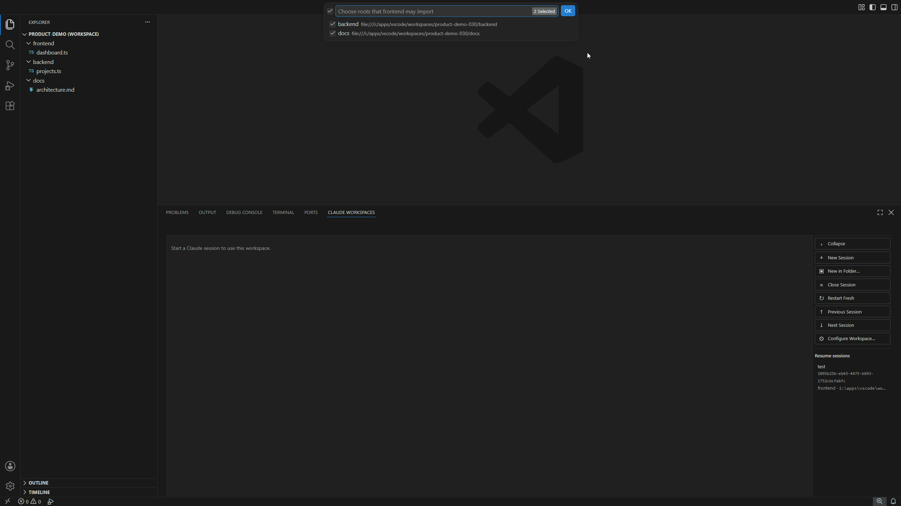
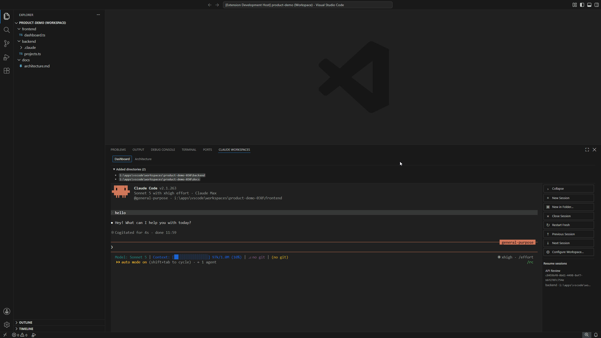
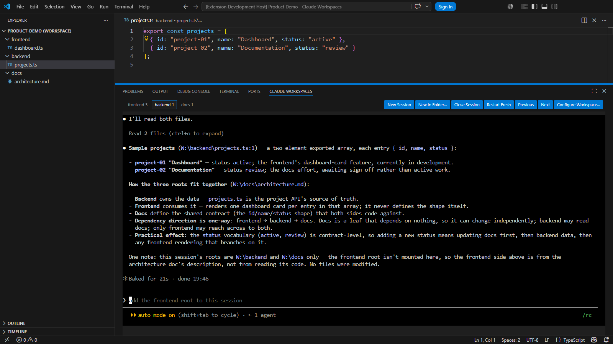

# Claude Workspaces

Manage workspace-aware Claude Code sessions across VS Code multi-root workspaces.

## Features

- Start Claude Code in any root of a saved multi-root workspace.
- Configure directed cross-root imports for each workspace root.
- Keep multiple live sessions organized in one VS Code panel.
- Receive a native Windows notification when a background session needs input.
- Rename supported sessions and resume them from saved metadata.
- Review each session's root, imported paths, status, and available actions.

## Install

Install the stable version of Claude Workspaces from the [VS Code Marketplace](https://marketplace.visualstudio.com/items?itemName=cbeaulieu-gt.vscode-claude-workspaces), or run:

```bash
code --install-extension cbeaulieu-gt.vscode-claude-workspaces
```

To install or switch to the pre-release channel, use the Marketplace action or
run:

```bash
code --install-extension cbeaulieu-gt.vscode-claude-workspaces --pre-release
```

Stable 0.10.0 promotes the published 0.9.0 prerelease snapshot, including automatic
default-root imports, configurable sidebar placement, and native notification
callback and PTY cleanup fixes. It requires Windows x64 and VS Code 1.128.0 or later.

The 0.11.x testing prereleases cover the rendering, input responsiveness
and activity reliability investigation
([milestone](https://github.com/glitchwerks/vscode-claude-workspaces/milestone/15)).
Version 0.11.1 adds the embedded prompt composer for hands-on testing. Physical
keyboard, layout and native queue-display acceptance remain open. The prerelease
installation command above selects the published testing build.

After updating, run **Developer: Reload Window** so the running extension host
loads the new version.

See the [versioning policy](docs/versioning-policy.md) for current channel
versions, the release cadence, and source packaging commands.

The extension is available only when VS Code has opened a saved
`.code-workspace` file. It intentionally does not activate in a folder window
or an untitled workspace.

## Feature tour

Choose which workspace roots each Claude session may import.



Name your active sessions and resume saved conversations from the sidebar.



Work with Claude Code in the embedded terminal, using the selected root and its
configured imports.



## Prompt composer (0.11.x testing prereleases)

The testing prerelease adds an embedded prompt editor below the active terminal (#145).
The unpublished **0.11.2 source candidate** adds skill/file coloring, advisory
invalid-reference warnings and inline slash suggestions, plus the layout and
button fixes described below. The currently published testing build is 0.11.1.
Drag its divider to resize it; the normal split is remembered for this workspace.
Expand temporarily gives writing more space. Hide and Show prompt editor preserve
text and move focus between the editor and terminal. Physical keyboard and layout
acceptance for this candidate remains pending.

Enter inserts a new line. The default composer bindings are Ctrl+Enter to send
and Ctrl+G to hide/show in the Sessions view. Find, Replace, Undo and Redo use
Ctrl+F, Ctrl+H, Ctrl+Z and Ctrl+Y while the composer has focus. **Shortcuts** opens
VS Code's Keyboard Shortcuts editor filtered to composer commands; bindings can
be changed there, including chords. Picker input and IME composition must finish
before sending. Direct terminal input remains available.

Each UUID-backed Claude session keeps its unsent text and selection in
workspace-local extension storage, separately from Claude's transcripts. Tab
switches, normal closes and restart/resume restore the last successfully saved
draft. **Saved** means storage acknowledged the write. Failed or oversized drafts
remain visible, but are not promised after restarting VS Code; the durable limit
is 1 MiB of UTF-8 text. Closing retains drafts. **Forget Session** removes the
session's saved metadata, draft and recent prompts. Saved drafts without an
eligible conversation appear under **Saved drafts**: **Restore draft** opens a
fresh session at the original, still-valid root and transfers the draft without
sending it. A changed or missing root leaves the source text intact.

Automatic sending requires a local Windows host, UUID-backed session, admitted
native hooks, and Claude CLI **2.1.299 or later**. Existing terminal/activity support
keeps its 2.1.287 minimum. Older identified sessions can still edit and save;
sessions without a UUID show an unavailable composer. Sending uses Claude's native
queue and its existing queue display. Existing terminal draft text or an active
dialog blocks automatic sending. The editor clears only the unchanged revision
that Claude accepts. Unconfirmed delivery retains the draft and never retries
automatically: inspect the native queue before explicitly clicking Send again or
editing the text.

**Skills / commands** searches the live session's effective catalog. Selecting an
item inserts its exact invocation without running it; stars are workspace
favorites. **@ File** offers at most 100 results from the session's launch root and
added directories, honoring workspace file exclusions and rejecting paths that
escape those roots. It inserts a quoted reference and does not upload file bytes.
**Recent** keeps only accepted composer prompts (up to 20 prompts and 256 KiB per
session), with explicit Replace/Append recall. **Preview** renders basic Markdown
from the unchanged draft; raw HTML, executable links and image loading are disabled.

In the 0.11.2 candidate, typing a leading slash offers matching native invocations.
Tab or Enter accepts a selected suggestion; Enter otherwise inserts a newline.
Tab without a selected suggestion and Shift+Tab retain normal focus navigation. Sending is
suppressed during suggestion selection or IME composition. The searchable browser
remains available as a reference. Long results show ellipsis; hover or focus to
read the full text. Expand changes to Collapse while expanded.

Command discovery retries automatically while Claude starts, with at most six
attempts and increasing delays. If commands remain unavailable, use **Refresh**
in **Skills / commands**. These retries only read the command catalog; prompt
submission is never retried automatically.

Recognized invocations and explicit @file references are colored. Wavy underlines
flag confirmed unknown commands or missing files without blocking save or send.
Checks are limited to 100 references and the session's permitted roots. Quoted
paths with spaces are supported; unavailable catalogs, inaccessible paths and
unfinished tokens are not presented as confirmed invalid references.

Shortcuts remain owned by VS Code, including custom bindings and chords. To
inspect a conflict, open **Shortcuts**, right-click a binding and choose **Show
Same Keybindings**. **Developer: Toggle Keyboard Shortcuts Troubleshooting** logs
which command VS Code invokes. Automatic winning-binding detection and forced
capture of arbitrary customized shortcuts remain unavailable; no separate local
keymap is installed (#204, #205).

## Configuration

Claude Workspaces stores its configuration in VS Code's workspace-local extension
state; it never writes to the `.code-workspace` file. On first use, and whenever
the ordered workspace folder set changes, it prompts for an optional default root,
automatic default-root imports, and directed cross-root imports. Dismissing the
prompt keeps the first workspace folder as the effective default and disables
every cross-root import.

For Claude Code installations that support UUID-backed sessions, the same
workspace-local extension state stores resumable-session metadata: the Claude
session UUID, display name, original root identity, root label and path, creation
time, and last-launch time. Claude Workspaces does not copy or store Claude's
transcript contents.

`claudeWorkspaces.claudeExecutable` is an optional string setting for a Claude
executable path or command. Leave it unset to use `claude` from the extension
host's `PATH`.

`claudeWorkspaces.sessionSidebarPosition` places the action sidebar on the
`left` or `right` of the terminal (default: `right`). Changing it moves the
sidebar immediately and preserves its collapsed state and running sessions.
Actions stay at the top; resumable sessions appear below and scroll independently.
Collapsed buttons show their full action names on hover.

`claudeWorkspaces.sessionSidebarInitiallyExpanded` defaults to `true`. Set it
to `false` to start with icon buttons in a new window or newly opened Sessions
view. The sidebar toggle controls the current view; changing this preference
does not override that choice until a new view opens.

`claudeWorkspaces.sessionDetailsInitiallyExpanded` controls whether the session
details bar starts expanded and defaults to `true`. The bar shows the launch
root and the exact `--add-dir` paths supplied when the active session launched.
The launch root is the directory where the session started, not a live tracker
of later `cd` commands; collapsing the bar does not change the running session.

### Waiting-session notifications

Native waiting-session notifications are available only from a local Windows x64
extension host; remote extension hosts are an explicit no-op. A notification is
raised only when an unfocused VS Code window receives a `permission_prompt`,
`agent_needs_input`, or `elicitation_dialog` hook event. `idle_prompt` moves a
session to idle when no subagent remains active. Confirmed response completion
moves it to waiting once background subagents have finished; neither event
notifies. A stage
opened while its window is focused is already seen, so losing focus later does
not fire a notification.

In the live session tabs, a blue-ring working indicator means Claude is working;
it remains visible while background subagents run after the parent response ends.
It clears after the last subagent finishes unless the parent is still working.
A genuine permission or input request takes precedence over background activity.
A green dot means a completed response has not been viewed. Selecting that live
tab in the visible panel clears the unread response dot but leaves the session
waiting. Selected, starting, and closing styles remain independent from both
activity indicators.

Attention hooks attempt delivery up to three times on transient file I/O
failures. The admitted completion reporter also retries a confirmed subagent
completion after five seconds. If that retry's writer fails, it permits two
further attempts after 15 and 30 seconds. These are scheduling intervals;
delivery can take longer. A delayed retry cannot finish a newer tracked run of
the same agent. Parent completions are not retried, preserving unread-response
behavior.

Recovery retains at most 256 active or pending child records and publishes one
retry at a time. Additional concurrent agents use ordinary paired completion
tracking. Retries run independently of the original completion hook; they do
not infer completion from elapsed time or agent inventory. Worker exit/reload,
missed hook dispatch, unavailable timers, or continued channel failure can
still leave the working indicator visible until the session closes. Delivery
errors remain visible in Claude.

If the reporter's timer API fails, that worker stops scheduling recovery
retries until it reloads. Ordinary completion delivery continues; a failed
cancellation cannot accumulate replacement timers.

Background-agent activity tracking requires **Claude Code 2.1.287 or later** and
an admitted completion reporter. Claude Workspaces adds its bundled reporter
with `--plugin-dir`, preserving existing plugins and settings. It tracks starts
and confirmed `turn.complete` events together; a blocking `SubagentStop` or
`Stop` hook does not confirm completion.

Older CLIs can still run ordinary sessions and supported input notifications.
When the reporter is unavailable, the extension warns and disables background
tracking. Safe mode, `disableAllHooks`, organization policy, or Anthropic's
remote rollout can prevent reporter loading even on a newer CLI. If all hooks
are disabled, no activity metadata is available. Anthropic documents that a
remote rollout refusal cannot be enabled by a local setting in its
[mod availability troubleshooting guide](https://code.claude.com/docs/en/plugins/mods/troubleshoot#check-whether-mods-can-load).

The Claude Workspaces panel tab badge counts every live session waiting for input,
including responses that have already been viewed. It disappears when no live
session is waiting.

The toast names the workspace and managed session. Selecting it reveals the
Claude Workspaces panel in the existing owner window and activates the
correlated live session and requests focus for its terminal input without
opening another VS Code window. On Windows, the
extension also asks VS Code to focus that existing window. The owning VS Code
taskbar entry may highlight or flash; native notifications cannot
guarantee programmatic foreground activation. Selecting a stale toast after its
session or owner window closes is a no-op and does not open an empty window.
Enhanced foreground and keyboard activation is tracked separately in
[#176](https://github.com/glitchwerks/vscode-claude-workspaces/issues/176).

The extension keeps native callback handlers running while selectable
notifications remain, including after the banner fades. Closing or exiting a
managed session cancels its pending callbacks and immediately stops owned
helpers if no live callbacks remain. Other live-session callbacks retain their
seven-day expiry, and extension shutdown also stops owned helpers.

`claudeWorkspaces.waitingSessionNotifications` defaults to `true` and controls
native Windows notifications. Its value is read for each newly opened waiting
stage, so a setting change applies without reloading VS Code. Disabling it does
not disable hook ingestion or session activity tracking. Waiting detection also
requires a Claude Code version that supports `--settings` and preserves the
extension's routing variables in hook processes. On validated Claude Code
2.1.307, `CLAUDE_CODE_SUBPROCESS_ENV_SCRUB=1` retained those variables and
notifications continued working. Enabling credential scrubbing alone does not
establish a missing-routing failure. If a wrapper or policy removes the routing
variables, `UserPromptSubmit` reports a non-blocking hook error containing
`Claude Workspaces attention hook failed: Attention channel environment is
unavailable.` No Claude Workspaces Output diagnostic is expected for that
failure; `Notification` ignores hook stderr. See the
[env-scrub runbook](docs/manual-verification/waiting-session-notifications.md#env-scrub-diagnostic).

## Commands and sessions

The Claude Workspaces panel and Command Palette provide New Session, New in
Folder, Close Session, Restart Fresh, Previous/Next Session, and Configure
Workspace. Sessions are owned only by this extension: closing or deactivating
the extension terminates its managed Claude processes without changing VS Code
terminals or externally launched Claude processes. Saved conversations appear in
the panel's separate **Resume sessions** list after their live process closes.
Opening and closing a session without sending a prompt does not create a saved
conversation, so it stays out of the list.
Retry and Restart Fresh always resolve the current workspace configuration before
launching.

Run **Claude Workspaces: Show Claude Workspaces** from the Command Palette to
reveal the panel and focus its Sessions view. The command has no default
shortcut. To assign one, open **Preferences: Open Keyboard Shortcuts**, search
for **Show Claude Workspaces**, and choose your preferred key combination.

Right-click a session tab and choose **Rename Session…** to give that live
session a custom display name. Choose **Close Session** to close that specific live
session. The menu is also available with `Shift+F10` or the Menu key while the tab
is focused. Renames are saved for UUID-backed sessions and reused when those
sessions resume. Restart Fresh creates a separate new session with the normal
generated name.

Choose a saved entry under **Resume sessions** to reopen it in its original
workspace root. Before launching, Claude Workspaces verifies that the root is
still present at the exact saved path and resolves the current executable,
cross-root imports, and filesystem availability. A UUID already represented by
a live managed session is hidden from the resume list and cannot be launched a
second time.

Each entry shows its full Claude session ID and a relative **Last opened** time
beneath its name, so similarly named or older conversations remain
distinguishable. The relative value refreshes while the panel stays open; hover
the entry to see the exact launch time in your local timezone.

Right-click an entry under **Resume sessions** and choose **Forget Session**
to remove its saved metadata. With the entry focused, `Shift+F10` or the Menu
key opens the same menu. Forgetting removes the entry from this workspace’s
resume list; it does not delete Claude transcripts or stop another session.

**Forget Session** is also available from failed-resume notifications. If the
saved root is missing or has changed, the notification also offers **Start New**
and **Configure Workspace…**. If Claude rejects a stale session, it instead
offers **Start New** and **Open Logs**. Dismissing either notification keeps the
saved metadata.

HTTP and HTTPS links in session output can be opened through VS Code with
Ctrl+click on Windows/Linux or Cmd+click on macOS. A regular click remains
available for terminal text selection.

Use **Configure Workspace…** to select an optional default root, choose whether
other folders automatically include it, and select directed cross-root imports.
**Automatically include the default root** is enabled for newly configured
workspaces. **Use only selected imports** disables that convenience default;
explicitly selected imports still apply. Existing saved configurations migrate
with automatic imports disabled and their directed imports preserved.

Automatic imports follow the current effective default root, including the
first available folder when the configured override is unavailable. Sessions
started in that root do not import themselves, and explicitly selecting the
default root does not add it twice. The automatic policy is stored separately
from directed imports, so switching it off leaves those selections intact.

Reopening the command highlights the saved default root and automatic-import
option and checks each saved import that is still part of the workspace, so you
can adjust the current configuration instead of rebuilding it. Cancelling any picker keeps
the previously saved configuration unchanged. A launch starts Claude in its
selected root and passes each enabled available import as a separate `--add-dir`
argument.

## V1 limitations

V1 is session-oriented rather than a general terminal or a Claude conversation
client. It does not reconnect to a still-running process, adopt externally
launched Claude sessions, run outside a saved workspace, or provide
general-purpose terminal features. Resumption is available only when the
configured Claude executable advertises both `--session-id` and `--resume`;
if either flag is unavailable, or if the capability probe errors or times out,
new sessions still launch normally but do not create resumable metadata.

Claude owns transcript storage, retention, and cleanup. Claude Workspaces neither
inspects nor deletes those transcript files, so saved metadata can outlive the
Claude transcript it identifies. See Claude Code's
[session documentation](https://code.claude.com/docs/en/sessions) for the
transcript lifecycle.

Workspace-level `CLAUDE.md` configuration and shared skill discovery are future
scope, not current features.

### Claude Code IDE integration can switch panels

When a Claude Workspaces session is connected to the official Claude Code IDE
integration in VS Code, editing an existing file can open a diff and switch the
active panel to the integrated Terminal. The upstream IDE integration reveals
the Terminal after opening the diff; this is not caused by Claude Workspaces'
notification hooks. See the [confirmed reproduction](https://github.com/glitchwerks/vscode-claude-workspaces/issues/28#issuecomment-5787168418).

This is a known limitation when keeping the Claude IDE integration enabled.
Claude Workspaces has no supported way to prevent that upstream panel switch
while preserving the IDE connection. Disabling the connection also removes its
IDE features, so it is not a fix that preserves the integration.

To return, select the **Claude Workspaces** panel or run **Claude Workspaces:
Show Claude Workspaces** from the Command Palette. Intentional navigation to
the Terminal remains available.

## Runtime requirements

- Windows x64
- VS Code 1.128.0 or later
- Claude Code installed and available on the VS Code extension host `PATH`, or
  configured with `claudeWorkspaces.claudeExecutable`

## Development prerequisites

- Node.js 24 (recommended)
- npm

## Troubleshooting

- Save the workspace as a `.code-workspace` file before using the commands or
  panel.
- Verify that `claude` is available on the VS Code extension host `PATH`, or
  set `claudeWorkspaces.claudeExecutable` to the executable path or command.
  Paths containing spaces are supported.
- Use **Configure Workspace…** after workspace roots change or when a launch
  skips unavailable local or network import roots.
- If a saved root was removed, renamed, or moved, choose **Start New** to launch
  from the current default configuration, **Forget Session** to remove its saved
  metadata, or **Configure Workspace…** to review roots and imports.
- If Claude rejects a saved UUID after its transcript was cleaned up, choose
  **Start New**, **Forget Session**, or **Open Logs**. Closing the notification
  leaves the saved metadata unchanged.
- If no **Resume sessions** entries appear, run `claude --help` using the same
  executable configured for the extension and confirm that it lists both
  `--session-id` and `--resume`. A failed or timed-out help probe also skips
  resumable metadata, but it does not block normal new-session launches.
- If Claude exits immediately or fails to start, use the notification's
  **Retry** or **Open Logs** action to inspect the Claude Workspaces output.

### Diagnostic logging

To inspect extension diagnostics, open **View: Output** and select the
**Claude Workspaces** Output channel. Set `claudeWorkspaces.logLevel` to one of
`off`, `error`, `warn`, `info`, `debug`, or `trace`; it defaults to `info`.
`error` shows failures, `warn` adds recoverable conditions, and `info` adds the
normal extension lifecycle. Use `debug` or `trace` to gather more detailed
diagnostics, then return to `info` when finished. Changes apply immediately;
you do not need to reload VS Code or recreate a session.

The channel never logs Claude prompts, responses, terminal traffic, environment
values, or sensitive carrier arguments.

For an activity indicator problem, run **Claude Workspaces: Capture Activity
Diagnostics** from the Command Palette before reproducing it. The command opens
the Output channel and temporarily records activity events, hashed correlation
IDs, agent counts, and state changes, even when regular logging is off. Run it
again to stop. Capture stops automatically after five minutes or 256 events,
and on extension shutdown; it does not change your settings. Share only lines
marked `"diagnostic":"activity"` from that capture.

For slow typing or display stalls, run **Claude Workspaces: Capture Terminal
Diagnostics**, reproduce the stall, and run the command again to stop. The
Output channel records numeric timing histograms, character counts, queue
pressure and hashed session IDs in one-second windows, even when regular
logging is off. Share lines marked `"diagnostic":"terminal"`; terminal/key
contents, paths and raw session IDs are excluded. Capture is off by default
and ends after 256 aggregate windows or five minutes, on extension shutdown,
or when its renderer document is replaced. No settings are changed.
Manual stop flushes the frontend's final partial window before ending capture.
If the frontend does not acknowledge within one second, capture ends with a
`frontendDrainTimeout` counter; terminal input and output continue while waiting.

Host and frontend clocks stay separate: acknowledgements measure local round
trips, while PTY writes, host action-queue residence, frontend parsing and
render/fit spans have their own metrics. `outputHandlingMs` includes synchronous
host output logging, replay-buffer preparation and posting to the frontend.
Parsing completion does not prove
that a character was painted. Live correlations sample at most ten per second
per direction, retain at most 128 pending records, and expire after 30 seconds.
Background output reserves half the sampling budget for the active session.
At most 16 session aggregates plus global counters are retained per window;
omitted, sampled-out and expired observations are counted. Historical replay
is counted separately and never receives a fresh live-output correlation.
`pendingMessages` observes at most 128 host delivery promises at once; excess
observations increment `dropped` while terminal messages continue normally.
Session removal counts retired frontend samples as omitted. The host recognizes
up to 128 recently retired owned IDs for 30 seconds within the same capture,
so an in-flight window can retain its remaining active-session measurements;
windows naming unknown IDs are rejected.

With `claudeWorkspaces.logLevel` set to `debug`, notification diagnostics also
record launch requests, callback actions and whether they match a pending
notification, panel-focus completion, session activation, window-focus
requests/completion and terminal-focus requests. These records contain no
notification text, workspace path or callback payload. Focus completion records
the VS Code command result; it
does not prove Windows brought that window to the foreground. A terminal-focus
request does not establish that the webview received keyboard focus.
Focus-result diagnostics report only whether the embedded document has focus
and whether its active element is inside the target terminal, immediately and
500 ms after the request. They record no keys or prompt text and do not prove
that terminal input was delivered.

## Development

The browser build bundles xterm, CodeMirror and the Markdown preview parser locally. Their packages are pinned
build dependencies; no CDN assets are needed by the session panel. Composer UI
tests run with the existing unit-test command; real keyboard/rebinding checks run
in the VS Code host.

Feature pull requests target `prerelease/0.11.x`. Published prerelease 0.9.0
is promoted unchanged to stable 0.10.0. Use `npm run package:stable` to build
the stable VSIX, or `npm run package:prerelease` on the versioned pre-release branch.

Builds and test compilation automatically apply a pinned cleanup patch to
node-pty 1.1.0 for Windows session exits. Unexpected dependency source or version
changes fail the build; revalidate or remove the patch when upgrading node-pty.
The shipped VSIX includes the patched dependency.

See [CONTRIBUTING.md](CONTRIBUTING.md) for setup, validation, pull request, and
documentation guidance.

On Windows, `npm run measure:terminal-echo` opens an isolated VS Code test
instance and measures 288 ordered synthetic echoes with capture off/on, one
and four owned PTYs, idle/working indicator presentation, and the production
xterm adapter. Numeric results are written to
`.tmp/180-diagnostics/controlled-echo/results.json`. The workload uses synthetic
paste and a command echo child; it does not run Claude or establish physical
keyboard-to-paint latency. The first run may download the pinned VS Code test
version. Normal integration tests remain separate.

Run `node --test test/manual/programStatusTransport.unit.cjs` to check the
controlled transport runner's timeout and failure cleanup. On Windows, run
`npm run compile:tests` followed by
`node test/manual/programStatusTransport.smoke.cjs` to compare fixed OSC 7501
reply transport with Microsoft's Win32 input encoding. The ten owned-child
controls print metadata only and do not start Claude or change settings.
See the [native status findings](https://github.com/glitchwerks/vscode-claude-workspaces/blob/b11b1036e0a29ae961305509818ec75392aae26b/docs/reliability/native-status-evaluation.md)
for measured results and the remaining Claude negotiation and activity checks.

For a bounded retry-transport soak on Windows, compile tests, then run
`node --test test/manual/completionRecoverySoak.unit.cjs` and
`node test/manual/completionRecoverySoak.smoke.cjs --claude "C:/path/to/claude.exe"`.
Replace the quoted path with an existing Claude executable. The two controls
take about four minutes, provide no model prompts or terminal input, and write
numeric results under `.tmp/completion-recovery-soak/` (override with
`--output-dir`). They exercise synthetic metadata pairs through actual SDK
timers and PowerShell, with diagnostics disabled. They do not measure real
keyboard-to-paint latency. See the [recovery evaluation](https://github.com/glitchwerks/vscode-claude-workspaces/blob/b11b1036e0a29ae961305509818ec75392aae26b/docs/reliability/native-status-evaluation.md#bounded-sdk-transport-soak).

On local Windows x64, run `npm run compile:tests` followed by
`node test/manual/snoreToastActivation.smoke.cjs` to verify native COM callback
routing, handler renewal beyond one minute, and owned-process cleanup. The test
uses built-in Windows PowerShell 5.1, takes about 75 seconds, and requires other
SnoreToast helpers to be stopped. It does not display a toast or change Windows
registration. Complete the [notification checklist](docs/manual-verification/waiting-session-notifications.md)
separately for real notification selection and window behavior.

Each extension host with pending notification callbacks maintains two signed
SnoreToast helpers, briefly overlapping a third during renewal. The pinned
helper exits after one callback or one minute, so renewal starts roughly 2.4
helpers per minute per owner. Unselected callbacks expire after seven days;
closing the owner stops its helpers sooner.

## Publishing

Pushing a `vMAJOR.MINOR.PATCH` tag runs the
[Publish workflow](.github/workflows/publish.yml). The workflow verifies that
the tag matches `package.json`, derives the channel from the version, runs the
full validation suite, packages and publishes the Windows x64 VSIX, and creates
or updates the matching GitHub Release from [CHANGELOG.md](CHANGELOG.md). Odd
minor versions publish as pre-releases; even minor versions publish as stable
releases.

New features integrate through a versioned pre-release branch. Stable
candidates promote approved work from that line to `main`. See the
[versioning policy](docs/versioning-policy.md) for active branch names,
selective and full promotion, source provenance, and forward-porting rules.

The repository must provide an Actions secret named `VSCE_PAT` containing an
Azure DevOps personal access token with **All accessible organizations** access
and **Marketplace (Manage)** scope for the `cbeaulieu-gt` publisher. See the
[VS Code publishing documentation](https://code.visualstudio.com/api/working-with-extensions/publishing-extension)
for token creation and Marketplace prerequisites.

To retry an existing tag without moving it, open **Actions → Publish → Run
workflow**. Select that exact tag under **Use workflow from**, then enter the
same tag as the input. The selected ref and input must match; the same validation
and publication sequence runs against that immutable tag.

## Release enforcement for development

This prerelease line carries the release-policy authority synchronized from
protected main under issue #157. CI runs the policy tests, and the native
Release Guard validates each PR using the protected-main workflow. Feature PRs
target prerelease/0.11.x; main uses its required merge queue. Publication must
match current main-owned scripts, workflows, policy data and executable policy
tests. See [versioning policy](docs/versioning-policy.md) for approval and
forward-port commands.

Native guard logs retain redacted `releaseQueueReceipt` records for the job
token's fixed queue query/response fields, PR/ref identities before and after
evaluation, and the proved tree. An outdated main-targeting source branch must
be updated to current main and checked again before queue retry.
