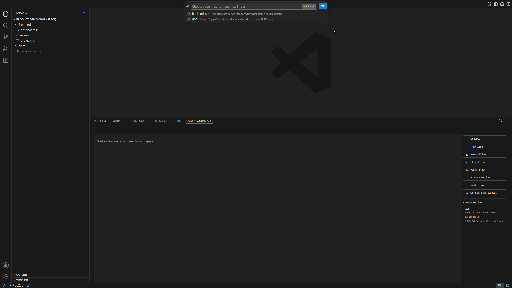
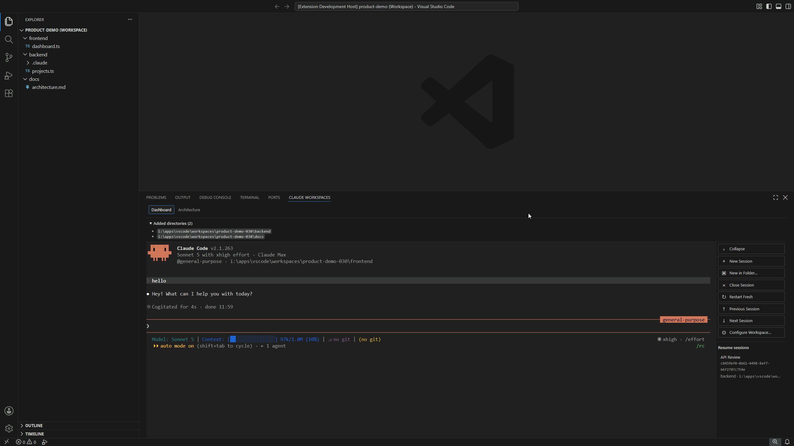
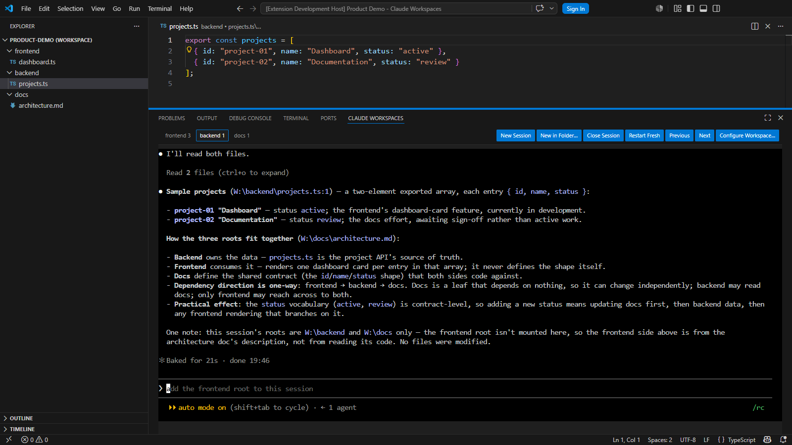
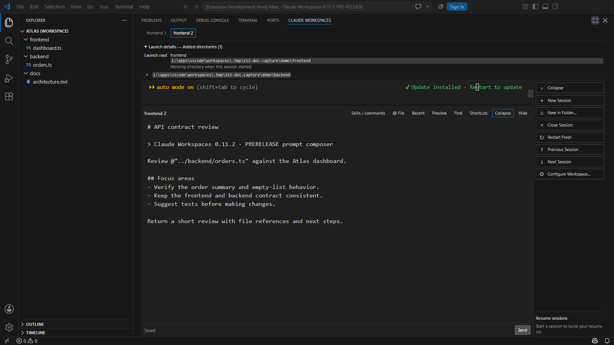
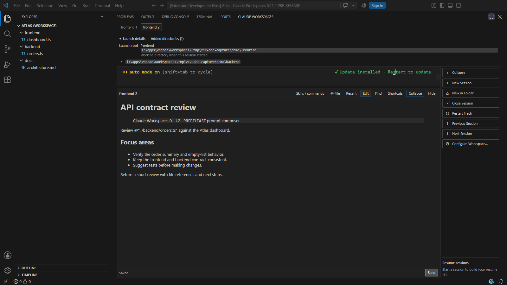

# Claude Workspaces

Run Claude Code across the projects in your VS Code workspace. Keep sessions,
workspace context, and saved conversations together in one panel.

## Features

- **Work across projects.** Start a session in any workspace folder and choose
  which other folders Claude can access.
- **Keep sessions organized.** Switch between named sessions without juggling
  terminal windows. See each session's launch folder and imported paths.
- **Pick up where you left off.** Resume saved conversations in their original
  workspace folder.
- **Know when you're needed.** Activity indicators and native Windows
  notifications help you follow background sessions.
- **Compose before sending.** Write multiline prompts, insert file
  references and skills, and preview Markdown in the embedded prompt composer.

## Install

Requires **Windows x64**, **VS Code 1.128.0 or later**, and **Claude Code** on
your `PATH` (or set `claudeWorkspaces.claudeExecutable`).

Install from the [VS Code Marketplace](https://marketplace.visualstudio.com/items?itemName=cbeaulieu-gt.vscode-claude-workspaces), or use:

```bash
code --install-extension cbeaulieu-gt.vscode-claude-workspaces
```

For the published **0.11.3 testing prerelease**:

```bash
code --install-extension cbeaulieu-gt.vscode-claude-workspaces --pre-release
```

Stable **0.12.0** is published from the validated 0.11.3 snapshot; see its
[publication receipt](https://github.com/glitchwerks/vscode-claude-workspaces/issues/217#issuecomment-6673727185).
The **0.13.x** development line is registered for the copying companion (#215);
no 0.13.x release is published. The composer screenshots were captured on
0.11.2 and illustrate features available in published stable 0.12.0.
Physical keyboard/layout, activity/notification and original typing/rendering
acceptance remain open under [release planning #215](https://github.com/glitchwerks/vscode-claude-workspaces/issues/215).
After changing versions, run **Developer: Reload Window**.

Open a saved **`.code-workspace`** file, run **Claude Workspaces: Show Claude
Workspaces** from the Command Palette, and choose **New Session**. Single-folder
windows and untitled workspaces are not supported.

## Feature tour

### Give each session the right context

Choose a default folder and directed imports so Claude can work across your
frontend, backend, and documentation.



### Switch sessions and resume conversations

Name live sessions, move between projects, and reopen saved conversations from
the sidebar.



### Work with Claude in one panel

Use Claude Code in the embedded terminal with your configured workspace context.



### Write richer prompts

Draft multiline prompts below the terminal, insert **@ File** references, browse
**Skills / commands**, and keep separate drafts for each session.

Drafts autosave after one second without edits. Switching sessions, hiding the
editor or sending a prompt flushes pending changes.



*Screenshot captured on prerelease 0.11.2; this feature is available in published 0.12.0.*

### Preview before sending

Check Markdown formatting without submitting the prompt. Resize or expand the
editor when you need more writing space.



*Screenshot captured on prerelease 0.11.2; Markdown preview is available in published 0.12.0.*

See the [user guide](https://github.com/glitchwerks/vscode-claude-workspaces/blob/main/docs/user-guide.md) for configuration, shortcuts, session
management, Claude CLI requirements, and troubleshooting.

## Development quickstart

Use **Windows x64**, **Node.js 24** (recommended), **npm**, and **VS Code 1.128.0+**.

```bash
git clone https://github.com/glitchwerks/vscode-claude-workspaces.git
```

Open the cloned repository in VS Code, then run:

```bash
npm ci
npm run check:types
npm run lint
npm run test:unit
```

Press **F5** to build and launch an Extension Development Host. Open a saved
multi-root workspace in that host and start a session. Manual session testing
also needs Claude Code installed.

The versioned pre-release branch **`prerelease/0.13.x`** is the registered
feature integration line (#220), initialized with development package 0.13.0.
Main retains the published 0.12.0 stable package; publishing requires separate
approval. Run `npm run test:integration` for extension-host checks.

See [CONTRIBUTING.md](CONTRIBUTING.md) for the full developer workflow and
[versioning policy](https://github.com/glitchwerks/vscode-claude-workspaces/blob/main/docs/versioning-policy.md) for packaging and releases.
README screenshots use immutable source URLs; the user guide and versioning
policy link to stable `main`. The source package configuration is preserved
for exact snapshot promotion.
