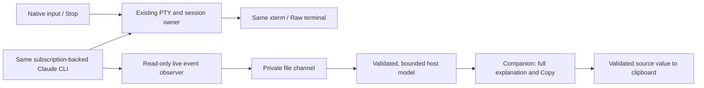

# Copy-friendly Claude Code companion

* **Author:** Christopher Beaulieu
* **Status:** Draft — Overview & Goals, Technical Plan and Alternatives Considered approved; Detailed Implementation and the optional-control scope await approval. [O; T; A4]
* **Date:** 2026-11-06
* **Parent:** [#215](https://github.com/glitchwerks/vscode-claude-workspaces/issues/215)
* **Predecessor:** [Finalized concepts brief](concepts_brief.md), approved for this first-version scope and formal drafting. [A]

Overview, The Problem, Goals and Non-Goals were approved on 2026-11-06. The author subsequently selected live capture only, selected private files and approved the Technical Plan and Alternatives Considered. Detailed Implementation below is drafted for review with two explicit optional-control variants. The [transport comparison](technical_choices.md#decision-2-live-content-transport) preserves the decision context. This document is not product implementation or release authorization. [A; O; L; T; A4]

## Overview

Provide a companion view for the existing subscription-backed Claude Code CLI that keeps Claude's full explanation readable while making commands and file/folder paths easy to copy. Show commands in separate blocks with Copy actions, and place Copy buttons beside paths in prose or inline code. Do not replace the explanation with an extracted-item list or short context snippets. [B:Overview; B:Goals vs. Non-Goals]

The same native CLI remains available through a raw-terminal toggle, including its question/permission interactions and native foreground Escape behavior. Direct question and permission controls are optional, rather than prerequisites for the copying feature. The technical design must keep these existing access paths usable while defining how complete, source-backed copy targets reach the companion. [B:Confirmed foundation; B:Native interaction remains a real integration concern]

## The Problem

Selecting a command from a terminal is awkward when it wraps across visual rows. File/folder paths are also mixed into Claude's explanation or inline code, so selecting them can accidentally include surrounding words or formatting. The user wants a direct Copy action for the complete command or just the path. [B:Overview; H:Anchored hypothesis and user problem]

Removing the explanation would make those items easier to isolate but would discard context the user explicitly wants to retain. The required experience therefore combines full explanation text with distinct command blocks and adjacent path controls. [B:Keep the full explanation; copy from source rather than presentation; F]

Copy targets also need honest boundaries. A path with spaces, quotes or punctuation may be uncertain; a command-shaped example is not automatically an instruction or an executed command. Clear paths must remain one-click, while uncertain paths must show the exact candidate and permit correction before copying. Source-backed provenance must distinguish what Claude displayed from what it actually ran. [B:Prose/inline paths remain core; B:Copyability and intent are different claims; P]

The experiments support feasibility for controlled command copying and the tested native interactions. They do not prove general prose-path recognition, reliable command-intent classification, packaged-extension behavior, accessibility or long-session performance. These remain acceptance and technical-design work, not capabilities this draft claims already exist. [B:Evidence supports further consideration; R:M1-M6]

## Goals

1. **Copy complete commands.** A Copy action returns the full intended command, preserving meaningful quoting and newlines without introducing terminal visual-wrap artifacts. Keep copying available for commands Claude displays and, where established by source evidence, commands it executed. [B:Goals vs. Non-Goals]
2. **Copy just file/folder paths.** Recognize paths within explanations and inline code, and put Copy beside the relevant path. The resulting value excludes surrounding prose and Markdown formatting. Clear paths require a single Copy action. [B:Goals vs. Non-Goals; P]
3. **Preserve full explanation context.** Keep the entire captured explanation visible and readable, including headings, lists and code; show commands in separate Copy blocks. An extraction-only view or shortened context is not a substitute. [B:Overview; F]
4. **Make uncertain path copying explicit.** Before copying an uncertain candidate, show exactly what would be copied and allow the user to correct it. Do not silently guess, and do not impose correction on ordinary clear paths. [B:Confirmed refinement, 2026-11-06; P]
5. **Retain trustworthy provenance.** Distinguish assistant-displayed examples/suggestions from source-confirmed tool execution. Do not let a Copy button imply that a command was recommended or ran merely because it looks like a shell command. Exact labels are a later design decision. [B:Copyability and intent are different claims]
6. **Keep the subscription-backed session.** Use the same interactive Claude Code CLI without requiring a separate API key, separately billed inference backend or replacement session for the companion. [B:Retained constraints; H:Confirmed needs and boundaries]
7. **Preserve native interaction and Stop.** The raw-terminal toggle remains usable for answering questions, approving/denying requests and other native interactions. Retain native foreground Escape semantics and do not equate a turn-abort acknowledgement with stopping a running command. Direct controls may be included separately if selected later. [B:Native interaction remains a real integration concern; B:Goals vs. Non-Goals]
8. **Make Copy usable and its limits visible.** Support keyboard-reachable actions, identifiable targets and perceivable success/failure feedback. Partial or unavailable capture must not masquerade as a complete copy target or full explanation. The exact acceptance checks and operating limits belong to the technical plan. [B:Proposed safeguards for the selected view; R:M1, M4-M6]

## Non-Goals

* Replacing the full explanation with a path/command list or small excerpts. The maintainer explicitly selected full context. [F]
* Automatically executing commands when they are copied. The tracked work is an output/copying feature, not command-execution automation. [#215; H:Confirmed needs and boundaries]
* Replacing subscription sign-in/inference with a separate API backend, or starting another CLI process solely for formatted output. [B:Retained constraints; R:M6]
* Making direct question/permission controls mandatory for first-version copying. Optional status is confirmed; whether to include them is still a technical-scope choice. [B:Goals vs. Non-Goals; R:M7]
* Treating full explanation visibility as a promise of unlimited retained history, complete native-interface replication or universal cancellation of background work. Capture/history limits still need to be designed without quietly discarding visible context. [B:Goals vs. Non-Goals; B:Native interaction remains a real integration concern]
* Adding path-opening/resolution, silent path transformations or a general intent-classification service as hidden prerequisites for Copy. Such behavior has not been selected; any proposed transformation or added dependency must be an explicit technical-design decision. [B:Prose/inline paths remain core; B:Alternatives Weighed]
* Implementing or releasing product changes during this drafting workflow. This authorization covers design documents. [A]

## Technical Plan

The author approved this section with live-only capture and the private file channel. This establishes the design below, not that its untested behavior works. Detailed Implementation must resolve the remaining recognition rules, operating limits, file inventory and acceptance fixtures before implementation could begin. References to proposed mechanisms below describe design intent, not shipped capabilities. [T; L; B:Remaining formal-design work; R:M1-M6]

### Data flow and ownership

Keep one subscription-backed CLI with two output paths. Its existing PTY continues feeding the same xterm. An observational mod sends allowed live content through a separate channel to an extension-owned companion model; the webview renders that model. Capture must continue native event processing unchanged and must not wait for a webview, transport acknowledgement or user action. The experiments support the event approach only within their recorded cases. [L; E; X; C; proposed integration]

The host retains the current reading window independently of the webview. Recreating a webview can project that retained model again; this is not CLI snapshot recovery. Do not call session.messages, tail transcript files or reconstruct commands from terminal rows. On late attachment, loss or eviction, insert a visible boundary explaining what is unavailable. Do not silently join text across a gap. [L; C; R:M1, M4; proposed failure contract]

Observe only assistant-visible explanation text and the tool command/result evidence needed for the displayed output. Do not forward hidden reasoning, signatures, arbitrary internal payloads or the whole session environment. Keep content out of the metadata-only attention publisher and ordinary diagnostics. Attention retains its existing notification ownership; the companion does not introduce a second activity-state authority. [B:Retained constraints; R:M6; M; proposed capture boundary]

### Protocol and retained model

Define a separate versioned content protocol. Each accepted frame is bound to the managed session, canonical CLI session identity, process generation and capture epoch, with sequence/revision information and native message/tool identities where available. The host derives current ownership from its own session state, validates payload shape/size, rejects stale or duplicate frames and exposes missing sequences as gaps. A local sequence number cannot establish a native message identity that the source did not provide. Identity and update behavior need qualification against the installed CLI declarations. [C; S; R:M1, M3-M4; proposed protocol]

The host owns ordered explanation blocks, source text revisions, associated tool evidence and immutable copy targets. A target records its source block/revision/range, complete literal value, kind and provenance. Rendering may wrap or add controls, but cannot manufacture the copied value. Any revision that changes a target invalidates its earlier action rather than silently copying a newer value under an old button. Incomplete payloads have no enabled complete-value Copy action. [B:Keep the full explanation; copy from source rather than presentation; R:M1, M3-M4; proposed model]

Transport queues, frames, retained content and view updates must have finite limits. Evict complete older blocks with an explicit history boundary; do not silently retain only the tail of a command or explanation. Oversized/incomplete blocks must be visibly unavailable for exact Copy, with raw access. Detailed Implementation will name byte/count/time limits, queue overflow behavior and slow-reader tests for the selected transport. The current PTY replay limit is not a rich-history retention policy. [X; R:M1, M4, M6; proposed limits]

### Full explanation, command blocks and path controls

Render the full retained explanation with headings, lists and code, preserving its order and context. Put command content in distinct blocks within that reading stream; place path actions beside their spans in prose and inline code. Keep tool requests/results visibly separate from Claude's explanation. Use text labels, keyboard-reachable buttons and perceivable Copy feedback rather than relying on color. Do not replace explanation paragraphs with extracted snippets. [B:Overview; F; R:M1-M3, M6; proposed presentation]

Use a source-mapped rendering/extraction layer so every action refers to retained source text, not DOM text or terminal selection. The runtime already uses markdown-it with raw HTML disabled, restricted links and image placeholders; those safety conventions are candidates for reuse. Its composer preview is not a ready-made source-mapped output renderer, and its reference parser deliberately skips inline code, so neither establishes the required path-copy behavior. [K; proposed reuse boundary]

For commands, copy the complete retained command body, excluding Markdown fence delimiters and added UI. Preserve meaningful quoting, spaces and logical newlines; never add visual-wrap breaks or silently trim the value. The Windows clipboard qualification permits only the previously tested one-to-one LF-to-CRLF newline conversion. Suggested/example identification must not change the value. A finalized command can become copyable while the surrounding explanation continues, provided its own source boundary is complete. Exact command-recognition forms remain Detailed Implementation work. [B:Goals vs. Non-Goals; E; R:M1, M3; proposed copy contract]

For paths, store the source span and literal path value separately from nearby Markdown/prose. Clear boundaries get one-click Copy. Uncertain boundaries get an editable preview of exactly the candidate value, with Copy after review; editing this preview changes only the local copy value. Do not resolve against the file system, expand variables, normalize slashes, remove quotes or strip line suffixes without an explicit agreed boundary rule. Supported Windows/POSIX, relative, quoted, spaced and line-suffixed forms need fixtures before implementation. General path recognition remains unproven. [P; B:Prose/inline paths remain core; R:M2; proposed extraction boundary]

### Provenance and clipboard actions

Keep assistant-displayed commands distinct from tool execution evidence. Proposed labels are **Suggested command** only when the supported source/context rule establishes an instruction, otherwise **Command shown by Claude**. A tool request alone is **Requested by Claude**, not proof of execution. Use an execution label only when correlated native evidence establishes it, with separate completion/interruption/unknown status; a single turn-abort flag is insufficient. No additional model call classifies intent. Detailed Implementation must specify the evidence table and ambiguity fixtures. [B:Copyability and intent are different claims; E3; R:M3; proposed labels]

A webview Copy action names the current target and revision; it cannot supply an arbitrary native input action. The host validates that the target still belongs to the displayed session and remains complete, then writes its stored literal value to the clipboard. For an uncertain path, the explicitly reviewed edited value is the value shown and copied. Failed or stale actions report failure and do not silently switch targets. Copy never submits to the composer, writes to the PTY or opens a path. [B:Goals vs. Non-Goals; P; R:M1-M3; proposed action contract]

Treat captured content as untrusted text: disable raw HTML/scripts and remote resource loading, use the panel's controlled link boundary and CSP, and create Copy controls only from extension-owned rendering logic. Assistant text cannot create permission or Stop actions. This extends the existing safe-preview conventions to the new renderer; it is not a claim that the composer preview already meets the output feature. [K; R:M6; proposed rendering boundary]

### Native access, Stop and optional controls

An always-available Companion / Raw terminal toggle switches presentation while retaining the same live PTY/xterm and composer draft. Preserve each view's scroll position. Selecting Raw terminal focuses that terminal; incoming output or capture failure must not steal focus. Questions and permissions remain answerable through native access regardless of capture health. The copying plan does not require a new question/permission owner. Direct controls retain their approved optional status and need a separate explicit inclusion decision before Detailed Implementation is final. [B:Confirmed foundation; R:M5, M7; X; proposed integration]

Stop sends one native Escape through the selected CLI's existing input path after checking the current session/generation. It must not depend on the content channel, globally capture editor Escape or queue a stale keystroke for another generation. Report input sent separately from confirmed interruption, and do not claim to stop already backgrounded work. Do not use turn.abort for Stop: the focused experiment observed a running shell become backgrounded and later finish, whereas native Escape stopped the timed fixture. Detailed Implementation must cover target freshness and pending native-dialog cases. [E3; N; B:Native interaction remains a real integration concern; proposed Stop integration]

### Components and API changes

These are proposed component locations for future implementation, not missing deliverables of this documentation PR. Detailed Implementation will enumerate every actual source, test and documentation file once the remaining choices are settled. [B:Remaining formal-design work]

| Component | Proposed responsibility / existing integration |
|---|---|
| New `media/companion/` observer | Capture allowlisted semantic events without changing their continuation; load through the existing mod entry without adding content to attention. [M; proposed] |
| New `src/companion/` host components | Own the chosen transport, schema/target checks, bounded source model, gaps and lifecycle cleanup. Reuse lifecycle conventions from the composer, with a separate content protocol. [C; proposed] |
| New `src/panel/companionProtocol.ts` | Define the host/webview projection and revision-bound Copy actions. Native input remains a separately validated action. [B:Remaining formal-design work; proposed] |
| New `src/panel/webview/companion/` components | Render full explanations, command blocks, source-bound path actions and uncertainty previews; handle focus and Copy feedback. [F; P; proposed] |
| Existing panel provider and renderer | Add companion projection/toggle routing while retaining xterm hydration/live output and the current input owner. [X; N; proposed] |
| Existing launch/session lifecycle | Provision and retire capture bindings with the owning process generation; do not change subscription authentication or launch a second CLI. [C; L; proposed] |

No Claude inference/API backend is added. The new APIs are local mod-to-host content frames and host-to-webview projections/actions. The selected transport is the private file channel described in [Decision 2](technical_choices.md#decision-2-live-content-transport), including its mechanism, costs and failure cases. Authenticated loopback HTTP is retained there as an alternative, not an automatic fallback. [T; L; C]

### Qualification before a product change

The recorded baseline is Claude Code 2.1.317 / Pro on the tested local Windows setup, not a general minimum or a supported-version matrix. Qualify the chosen source/transport in a packaged extension before declaring copying reliable. Required cases include long/multiline commands and actual clipboard values, clear/uncertain inline and prose paths, full explanation preservation, source updates/stale actions, denied and interrupted tools, gaps/overflow, session replacement, webview recreation, multiple sessions, keyboard/screen-reader use and native Stop/toggle behavior. Test the selected file channel's access controls, file locks, bounds and cleanup. [T; E; E3; R:M1-M7; proposed qualification]

If capture is unavailable or incompatible, present its status and raw-terminal access. A working terminal is a fallback, not evidence that the promised rich copying works. No new live experiment, supported CLI floor, delivery estimate or release claim is established by this design checkpoint. [B:Evidence supports further consideration; R:M6; proposed failure boundary]

## Alternatives Considered

The author approved this section before Detailed Implementation drafting. It carries forward the brief's Alternatives Weighed and the later source/transport decisions. **Rejected by author** identifies a documented selection or constraint; **not selected** and **open** do not imply that an untested alternative failed or that an optional feature was rejected. The selected baseline is the full-explanation companion, live capture only, private file transport, source-backed Copy and native access. [A4; B:Alternatives Weighed; F; L; T]

### Native terminal improvements or a hybrid as the main output view

Native formatting and keyboard copy helpers worked in the recorded classic-mode experiment; clickable inline Copy used the fullscreen mouse path. This could preserve more native presentation and avoid a second renderer, but the experiment did not establish ordinary prose/inline path copying across modes. Fullscreen preview behavior, grouped tool output and clipboard/focus compatibility remained qualification costs. A native or hybrid approach was not proven cheaper for the narrowed requirements. [V; B:Alternatives Weighed; R:M2, M5-M6]

**Rejected by author:** use the companion as the first-version presentation, with complete explanation context, separate command blocks and adjacent path Copy. Keep the native terminal as an accessible toggle. This is a selected UX direction, not a finding that native improvements cannot work. A raw-terminal-only baseline retains the original awkward-selection problem. [F; B:Overview; J]

### An extracted command/path list or shortened context

An extraction-only surface could reduce the amount of rendered explanation and retained presentation state, but removes context the author explicitly wants. **Rejected by author:** the companion must keep the full captured explanation visible, with commands and path actions within that context. A future auxiliary index would need separate scope and could not replace the explanation. No measured memory/performance advantage was established for this alternative. [F; B:Keep the full explanation; copy from source rather than presentation; R:M3-M4]

### Authenticated loopback HTTP instead of files

Loopback HTTP avoids per-event transport files, and the focused probe demonstrated a working local HTTP bridge. It would require a listener lifecycle, authentication, bounded requests/retries and environment-policy qualification. Files instead carry polling, transient disk-content, access-control and cleanup costs; neither transport by itself establishes exact copying. [C:Decision 2; E3; T]

**Rejected by author:** for v1, follow the existing private-channel ownership/cleanup pattern and concentrate qualification on complete source-backed copy values. This accepted integration-risk judgment does not establish that files are intrinsically more reliable. Reconsider HTTP if file-channel qualification exposes unacceptable delay, disk activity or operating constraints; changing transport is a new decision, not an automatic fallback. [T; C:Decision 2]

### CLI snapshot recovery or durable conversation history

Reading a bounded message snapshot could recover some content missed by live capture, but adds reconciliation with concurrent events. The inspected API is bounded, and snapshot identity, timing, compaction and source fidelity have not been qualified. A durable conversation-history product adds storage and lifecycle work beyond the requirement to display each captured explanation in full. [S; C:Decision 1; B:Goals vs. Non-Goals]

**Rejected by author:** use live capture only for v1 and defer CLI snapshot recovery. Show gaps for unavailable content and retain native access. This is a scope decision, not proof that recovery is infeasible. Durable history is not selected; temporary file transport is not a history feature. [L; T; B:Alternatives Weighed]

### Parsing terminal rows as the authoritative copy source

This could observe the existing PTY without a semantic content channel, but the terminal view includes wrapping and native UI behavior that do not establish complete command/path boundaries or execution provenance. The controlled experiment established copying from captured logical content, not a general terminal-row reconstruction algorithm. [Q; E; R:M1, M3]

**Rejected by author:** the approved Technical Plan copies complete retained source values and uses semantic events; terminal rows remain the raw fallback. Missed events cannot be repaired by presenting guessed terminal extraction as an exact source value. Transcript-file tailing is also outside the approved source path; no claim is made here that every possible transcript reader is infeasible. [T; L; Technical Plan:Data flow and ownership]

### A separate API/SDK or headless output session

A different structured-output backend was an earlier research candidate, but its subscription/product eligibility and live-interaction equivalence were not established by the research. Do not generalize that uncertainty into a claim that every SDK invocation requires an API key. **Rejected by author:** replacing the existing subscription-backed interactive CLI, adding a separately billed inference backend, or starting a second CLI solely for formatted output conflicts with the approved foundation. The selected event/file path observes the same CLI. [Q; B:Retained constraints; Goals 6; Non-Goals; T]

### Strong command-intent inference and automatic path transformation

A classifier could try to distinguish instructions from examples, and resolution/normalization could try to make paths immediately usable. Neither proves the user's intended literal copy value. Extra model requests introduce usage/compatibility questions, while path transformations could alter quoting, slashes, variables or suffixes. The brief did not establish these as prerequisites. [B:Copyability and intent are different claims; B:Prose/inline paths remain core; R:M2-M3]

**Not selected as first-version mechanisms:** the approved Technical Plan uses source/context-backed labels, preserves literal values, and keeps the editable preview for uncertain paths. Do not introduce extra inference or filesystem resolution as an unapproved copying dependency. Exact recognition/boundary rules still need author decisions during Detailed Implementation; this section does not silently settle them. [T; P; B:Remaining formal-design work]

### A full conversation interface with direct question/permission controls

Direct controls could reduce terminal switching, and the focused experiment supports particular question/permission cases. They add request correlation, response ownership, stale-action and native-handoff work; feasibility in those cases is not general packaged support. **Open, not rejected:** include or defer direct controls only through an explicit later scope decision. Their optional status does not reduce the required native question/permission access, foreground Escape or raw-terminal toggle. The broader historical proposal is not blanket v1 approval. [B:Alternatives Weighed; E3; T; R:M5, M7]

## Detailed Implementation

**Draft for author approval.** The following is one implementation list. It proposes exact files, rules and limits for the approved architecture, with two selectable question/permission variants in item 9. Numbers are proposed engineering budgets, not measured capacity or latency claims. Approval must select a variant or request changes; neither is currently selected. No production files are changed by this document. [A4; T; B:Remaining formal-design work; R:M1-M7]

1. **Establish the implementation baseline and exact file inventory.** Target the runtime at ef5fd48f4b676881a8730afbf8e583e70565ca11, rechecked during this drafting step. The policy-only documentation checkout is not the runtime baseline. Before future implementation, create the implementation issue(s) and a milestone if split across issues, obtain implementation authorization, and use the required feature worktree/release lane. Do not close #215 merely because these documents merge. The following paths are planned future work, not files claimed to ship in this documentation PR. [A4; D1; #215; J]

   The earlier component-location table was provisional. For the exact inventory, put mod helpers under the already packaged plugin's `media/attention/hooks/companion/` subfolder and register them through its existing entry. This supplies the proposed companion observer without another plugin manifest or a cross-plugin import. Content still uses its own channel; the attention publisher remains metadata-only. This is the proposed exact placement for review, not a claim that these files already exist. [Technical Plan:Components and API changes; M; D2; D3]

   | Action | Exact path(s) | Change and reason |
   |---|---|---|
   | Create | `src/companion/companionTypes.ts` | Define capture identities, schema version, source/copy records, states and the limits in item 4. Keep these independent of composer send/clear authority. [T; proposed] |
   | Create | `src/companion/companionCapture.ts` | Own channel directories, staging promotion, validation, acknowledgements, timers and cleanup. [C; D1; proposed] |
   | Create | `src/companion/companionModel.ts` | Assemble complete source revisions, associate tool evidence, retain bounded full messages and invalidate targets on replacement/eviction. [T; proposed] |
   | Create | `src/companion/companionContent.ts` | Produce source-mapped Markdown nodes, command targets, path candidates and provenance labels using items 5-6. [P; F; K; proposed] |
   | Create | `src/companion/companionRuntime.ts` | Compose capture with session lifecycle, current target/document checks, clipboard writes and native Escape dispatch. Inject clock/file/clipboard dependencies for tests. [D2; N; proposed] |
   | Create | `src/companion/companionCapabilities.ts` | Declare the qualified CLI-build/schema combinations and reject unsupported host/version combinations without changing launch support. [D1; R:M6; proposed] |
   | Create | `src/panel/companionProtocol.ts` | Decode closed host/view message unions, chunked hydration, target revisions, Copy/preview/toggle/Stop requests and feedback. [T; proposed] |
   | Create | `src/panel/webview/companion/view.ts` | Render the full reading stream, command/status blocks, adjacent path buttons and capture-gap notices. [F; proposed] |
   | Create | `src/panel/webview/companion/copyPreview.ts` | Own the local editable uncertain-path dialog, focus restoration and revision-bound review submission. [P; proposed] |
   | Create | `src/panel/webview/companion/styles.css` | Use existing VS Code theme variables for separated blocks, visible focus, path actions and status text. [F; R:M6; proposed] |
   | Create | `media/attention/hooks/companion/observer.js` | Observe stored assistant text and allowlisted tool evidence; preserve native continuation and enqueue content without I/O waits. [D1; M; proposed] |
   | Create | `media/attention/hooks/companion/filePublisher.js` | Own the bounded mod queue, write-once staging/marker sequence, acknowledgements, heartbeat and epoch cancellation. [D1; proposed] |
   | Modify | `media/attention/hooks/register.js` | Supply a capability driver with literal capture environment names and register/reset the companion helpers independently of attention/composer. [M; D2; proposed] |
   | Modify | `src/extension.ts` | Construct the runtime, compose prepareLaunch after the existing composer preparation, inject clipboard access and dispose capture on shutdown. Reuse read-only targetFor ownership, not composer submission availability. [D2; proposed] |
   | Modify | `src/launch/sessionLaunch.ts` | Add capture-only environment overlays for directory, token, managed session, CLI UUID and generation without editing credentials or user settings. [D2; proposed] |
   | Modify | `src/panel/protocol.ts` | Route the new namespaced messages through the companion decoder and include its projection union. [D2; proposed] |
   | Modify | `src/panel/sessionPanelProvider.ts` | Bind projection/actions to the current renderer document and selected session; supply the toggle and preserve xterm hydration/live output. [X; proposed] |
   | Modify | `src/panel/webview/renderer.ts` | Mount the companion alongside the existing retained xterm, route state/actions, preserve separate scroll/focus and import companion styles. [X; N; D2; proposed] |
   | Modify | `src/panel/webview/styles.css` | Size the output/toggle/Stop region without changing composer sizing or terminal mount ownership. [D2; proposed] |
   | Create | `test/fixtures/companion/copy-cases.json`; `test/fixtures/companion/capture-cases.json` | Retain expected literal command/path values, source spans, labels, chunk/gap/lifecycle inputs and boundary cases. These fixtures must be committed with their consumers. [R:M1-M6; proposed] |
   | Create | `test/unit/companionCapture.test.ts`; `test/unit/companionModel.test.ts`; `test/unit/companionContent.test.ts`; `test/unit/companionRuntime.test.ts`; `test/unit/companionCapabilities.test.ts`; `test/unit/companionProtocol.test.ts`; `test/unit/companionView.test.ts`; `test/unit/companionNativeMod.test.ts` | Test transport failure/cleanup, exact assembly/eviction, recognition/copy values, stale actions/native input, capability admission, decoding, DOM/a11y interaction and unchanged mod continuation respectively. [R:M1-M6; proposed] |
   | Modify | `test/unit/sessionLaunch.test.ts`; `test/unit/protocol.test.ts`; `test/unit/webviewRenderer.test.ts`; `test/unit/activation.test.ts`; `test/unit/packageAssets.test.ts` | Add overlay isolation, namespace rejection, retained-terminal/toggle behavior, composition/disposal and packaged helper-asset regressions. [D2; proposed] |
   | Create | `test/integration/companion.test.ts`; `test/support/companionHarness.ts` | Exercise provider/runtime integration with fake PTYs, deterministic capture and the real VS Code clipboard API. [D2; proposed] |
   | Create | `test/manual/companionNative.smoke.cjs`; `test/manual/companionNativeWebview.ts` | Supply separately invoked owned-CLI fixtures for packaged/native/clipboard qualification; never include model-consuming probes in ordinary unit tests. [E; E3; proposed] |
   | Modify | `README.md`; `docs/user-guide.md` | Explain Companion/Raw switching, supported copy forms, uncertainty, gaps, supported build scope and the selected control variant. [F; T; proposed] |
   | Create | `docs/manual-verification/215-companion.md`; `test/fixtures/companion/qualification.json` | Specify the manual matrix and retain sanitized results, exact build/auth metadata and clipboard comparison outcomes. Store content only from synthetic fixtures. [E; E3; R:M6; proposed] |
   | Modify | `docs/designs/215/design_draft.md`; `docs/designs/215/technical_choices.md` | Record approvals, final file placement, qualification findings and durable issue/PR references; retire the execution plan when the parent issue closes after extracting durable rationale. [A4; #215; proposed] |

   Variant B adds only the files listed in item 9. No file deletions, dependency upgrades, package scripts, build entry points, release/version changes or xterm adapter edits are planned: the existing build bundles the renderer's imports and the package includes plugin helper assets. Verify those assumptions with the asset/build checks; if they fail, revise the inventory explicitly. Current build/package/test entry points are pinned in D2. [D2; proposed scope]

2. **Admit a compatible capture session without changing authentication.** Initial qualification target: local Windows x64, VS Code satisfying the runtime manifest, Claude Code 2.1.317 using the existing claude.ai subscription. Admit only builds explicitly present in companionCapabilities after packaged qualification; do not claim a minimum version or infer future compatibility from a greater version number. A missing/unsupported build, unavailable plugin, remote host or failed handshake leaves the CLI usable with a visible capture-unavailable state and Raw access. Probe metadata only; never modify sign-in or collect credentials. Reuse the current session/CLI UUID/generation target even if composer sending is unavailable. [D1; D2; E; E3; proposed admission policy]

3. **Implement the private file transaction and observational lifecycle.** Host creates a random, user-protected channel beneath extension storage, with an ownership marker, a fresh 256-bit secret and generation binding. The exact child names are host-controlled; reject traversal, links/reparse redirection, foreign ownership and stale identity. Qualify inherited Windows access controls; mode bits alone are insufficient. Publish only a validated managed-session binding in the launch environment. Register session.start, classic.SessionStart, session.end, turn lifecycle and relevant append/tool observers through the existing entry; UUID/epoch changes cancel old callbacks and invalidate pending targets. The input process and xterm are not restarted on a view toggle. [C; D1; D2; T; proposed transaction]

   Observe session.append by awaiting its unchanged native continuation, then allowlist the returned stored assistant text, row UUID, block index and agent/turn correlation. Enqueue source observations synchronously and return the same native result without awaiting delivery. Tool evidence records only command text, tool-use ID and the fields required for provenance/status; do not forward complete internal inputs, reasoning or arbitrary attachments. Distinguish subagent scope, and never bind its events to the main conversation just because a tool name matches. [D1; E3; T; proposed source mapping]

   Each frame has schema version, token, managed session, CLI UUID, generation, capture epoch, sequence, message/block/tool identity, source revision, chunk index/count and declared UTF-8 length. The mod writes one bounded `.upload` file exactly once, awaits that write only in its publisher callback, then writes its bounded `.ready` marker; it never overwrites that sequence or waits inside an output observer. The host ignores partial markers, validates ownership/size/identity, atomically renames the staged frame to its committed name with Node fs, then reads/validates and admits its content. Acknowledgements are host-written through temporary-file rename only after admission or an explicit rejection. The host retires all consumed transaction files; the mod never assumes it can rename/delete through an undeclared API. Runtime channel files are temporary transport, not committed artifacts or retained history. [D1; C; proposed publication refinement]

   Keep one cumulative acknowledgement file until the channel retires, atomically replaced by the host with the highest consecutively admitted sequence (including explicitly accepted gap records). The mod retires its queued frames only after reading that cursor; individual upload/marker/committed files can then be removed by the host without racing an ephemeral ack. Retain the accepted cursor in host memory so acknowledgement loss/replay cannot duplicate model entries. A stale generation/token is rejected, never retargeted. Missing sequences or dropped observations produce one explicit gap range before any later content; never assemble a message across it. On a partial write, lock or timeout, retry within item 4's budget, then retire the failed epoch and mark its incomplete source unavailable. If even gap delivery fails, the host heartbeat timeout exposes capture loss. Cancel producer timers on retirement, delete only marked owned dead channels, and retain a content-free cleanup failure diagnostic when cleanup fails. The common copying path introduces no helper process, HTTP channel, transcript read or snapshot recovery. [T; L; D1; proposed failure rules]

4. **Use explicit finite budgets and test both sides of every boundary.** These are proposed limits for author approval, not experiment measurements. Implement UTF-8 byte accounting for content and separate fixed metadata allowances; never use UTF-16 string length as a byte limit. Retain complete messages or show them unavailable. [R:M1, M4, M6; proposed budgets]

   | Area | Proposed v1 budget / behavior |
   |---|---|
   | Content | 1 MiB per assistant message or command; 256 KiB per tool-result text block. Larger content gets an explicit unavailable placeholder; do not enable Copy for a retained tail. |
   | Frames | 64 KiB source chunks split at Unicode scalar boundaries; 256 KiB serialized frame including metadata; 4 KiB marker/ack. Reject malformed or oversized frames before model admission. |
   | Queue/disk | At most 64 queued frames or 4 MiB, whichever first; at most 8 outstanding staged transactions or 2 MiB per channel. Globally cap transport storage at 32 MiB and 256 files, including owned metadata; refuse further capture capacity visibly when full. Reserve one bounded gap/health record outside each data queue; no unbounded retry copies. |
   | Scheduling | Publisher and host polling every 50 ms while work exists, 250 ms when idle; one in-flight publisher operation. Heartbeat every 1 second; unavailable after 5 seconds without a valid heartbeat. Native continuation never awaits these timers. |
   | Failure | Handshake deadline 5 seconds; transaction/lock retry deadline 2 seconds. Retire the failed epoch on deadline; reconnect creates a new epoch and visible gap, not replay from lost history. |
   | Retention | 8 MiB source/derived-text budget per session and 32 MiB globally, at most 200 retained messages per session. Evict oldest complete message groups across sessions, preserve per-session gap boundaries, invalidate their Copy/review targets. Apply count bounds to derived nodes/targets too: 20,000 nodes and 2,000 targets per session. |
   | Webview | At most 64 KiB source chunks per projection message, one bounded hydration transaction; invalidate old hydration IDs. Mount complete message groups up to the retained window; if rendering is unavailable, retain source only within the same budgets and show a notice. |
   | User actions | At most 128 recent action IDs per renderer document; reviewed path/candidate at most 32 KiB. No Copy target may contain NUL. One in-flight host clipboard write, with a 2-second feedback deadline; do not claim that timeout cancels the platform write. Native Escape is dispatched once immediately to a currently running target, never retried after uncertainty. |

   Reassembling, parsing and rendering must yield between bounded chunks rather than scanning an unbounded session synchronously. On global eviction, show a history boundary instead of making an old preview look current. Instrument counts/bytes/durations only, with no content, tokens, path strings or raw frames in normal logs. Qualification must demonstrate the configured bounds under slow readers, four concurrent sessions and repeated webview recreation; do not turn proposed timer values into unmeasured latency promises. [T; R:M4, M6; proposed operating rules]

5. **Define literal Copy and the supported recognition grammar.** Host-side extraction owns source offsets and the copied value. Use Markdown block line maps plus a bounded raw-source inline scanner; correlate decoded display tokens with exact source spans. If Markdown normalization/escapes prevent a verified mapping, retain the explanation and offer review of the raw candidate instead of inventing an exact target. Store source UTF-16 offsets for slicing and UTF-8 lengths for limits. A complete capture boundary and a finalized target revision are required to enable Copy. [T; K; R:M1-M2; proposed grammar]

   | Input form | Proposed action and exact value |
   |---|---|
   | Closed shell fence tagged sh/bash/zsh/shell/powershell/pwsh/ps1/cmd/bat | One command block copies its entire body, excluding fence syntax and the structural newline before the closing fence. Preserve all other spaces, quotes and intentional newlines; do not split scripts or strip prompt characters. Untagged/other-language fences keep a generic code Copy action without asserting command intent. |
   | Single-line inline code immediately introduced by a standalone Run: / Run this command: / Execute: cue | Render a command block at that source position, retain all surrounding explanation and copy the full code body. Other command-like inline code has generic code Copy; no inferred execution label. |
   | Entire inline-code value or matched quoted prose value is a path | One-click path Copy for explicit drive-rooted, POSIX-rooted, UNC, ./, ../, ~/, separator-containing relative paths, or a bare filename with a nonnumeric extension. Exclude the enclosing Markdown code delimiters or matched prose quote pair; preserve path spelling, inner spaces, case, separators and trailing directory separator. |
   | Bare folder/basename in inline code | One-click path Copy only when directly introduced by file/folder/directory/path followed by whitespace or a colon; otherwise retain generic inline-code Copy. No filesystem lookup decides whether the name exists. |
   | Unquoted prose path with an explicit root/relative prefix or slash-separated components | Copy a space-free token when its endpoints are unambiguous. Whitespace ends the token. A terminal sentence-punctuation character, unbalanced quote/bracket, possible line suffix such as :12/:12:3, or a path containing unquoted spaces makes it a Review candidate. Show exactly the candidate with correction before Copy. |
   | Variables, URI/device syntax or uncertain escapes | Preserve variables literally; never expand them. URLs, Markdown destinations and ordinary identifiers are not auto path targets. Device paths, mixed prose/code spans, ambiguous punctuation or escape normalization use Review when a bounded candidate can be shown. Do not silently strip a suffix, normalize slashes or resolve a path. |

   Clear quoted/code path interiors can contain spaces. Command/fenced-code rules take precedence; do not insert path buttons inside an existing command target. Bare prose paths cannot safely consume arbitrary following words: take only a bounded path-bearing phrase up to the next sentence/line boundary for Review and label its exact candidate; never automatically copy the guessed phrase. An oversized candidate is unavailable, not silently cut into a path. A conservative omission remains a recognized coverage limit, not a successful path-copy case. Fixtures must include Windows and POSIX files/folders, UNC, spaces, Unicode, multiple paths, trailing slash, quotes, parentheses, Markdown emphasis, suffixes, URLs, identifiers and unclosed code/fences. Approve or revise these explicit coverage rules before implementation. [P; B:Prose/inline paths remain core; R:M2; proposed coverage]

   A Copy action names document/session/generation/target/revision; host verifies the complete immutable value immediately before calling the VS Code clipboard API. Edited uncertain-path Copy additionally carries the user's displayed value under a live review ID; it must not change the underlying source. Preserve literal value except the approved removal of syntax delimiters and one-to-one Windows LF-to-CRLF conversion at the clipboard boundary. Record expected LF and CRLF equivalents in fixtures; no trimming, Unicode normalization, shell escaping or slash conversion. Report success only after the write resolves and report stale/failure without silently copying a replacement target. While a write remains unresolved, reject further Copy actions as busy; after the feedback deadline report the outcome as uncertain and keep that ordering guard until it settles. Do not let a late first write overwrite a newer accepted Copy. [T; P; E; proposed clipboard contract]

6. **Make command provenance a tested evidence table.** Do not infer execution from formatting, a copy click, a request or turn completion alone. [T; R:M3; proposed states]

   | Evidence | Visible label/status |
   |---|---|
   | Assistant shell block, no strict instruction cue | Command shown by Claude; suggestion/example context remains visible. |
   | Assistant shell block following the exact affirmative standalone cues in item 5 | Suggested command. The cue rule makes no claim of general intent understanding. |
   | Correlated tool request, no execution/result evidence | Requested by Claude; execution not confirmed. |
   | Correlated native successful tool-completion evidence for that command | Claude ran this / Completed, with the tool source identified. |
   | Permission denied before execution, or unmatched result | Denied / execution not confirmed, or Unknown. Never mark it ran. |
   | Correlated explicit interrupted/backgrounded evidence | Interrupted or Backgrounded as reported. A missing/contradictory signal is Unknown, not successful termination. |

   Preserve distinct tool-use IDs even for identical command text. Never turn classic permission reason=answer/isAborted=false into successful execution or use a turn-abort acknowledgement as process termination. Retain displayed and executed Copy targets separately when the source differs. Use generic code/text rendering for unsupported tools instead of inventing a shell command. [E3; T; proposed reconciliation]

7. **Implement full-context rendering, safety and accessible feedback.** Generate extension-owned render nodes/actions from retained source; raw HTML, scripts, remote images and executable assistant-provided action URIs remain disabled. Reuse markdown-it and the existing link/CSP boundary without reusing the composer's incompatible reference parser as a path detector. Render headings/lists/code and all retained explanation text in order; no extraction-only replacement. Separate associated tool output/status. Path Copy stays adjacent to its source; buttons have target-specific accessible names, visible keyboard focus, Enter/Space behavior and live-region success/failure feedback. Review has explicit editable value, Copy/Cancel, local Escape and focus restoration. Output arrival does not steal focus or scroll an older reading position; auto-follow only when already at the end, otherwise show new-content indication. [F; P; K; T; R:M6; proposed UI contract]

8. **Preserve native input and Stop independently of capture.** Default to Companion only after successful capture admission; otherwise keep Raw visible with status. Keep the toggle and Stop available in either view. Store view selection and scroll position in session memory, not durable conversation history; keep the same xterm mounted. Native input still goes to SessionManager; Copy/review never submits to the CLI or composer. Target validation uses the current running session and process generation at dispatch, not a remembered active tab. Stop sends one native Escape, reports sent separately from confirmed interruption and never globally captures editor Escape. When turn identity is unavailable, label it Send Escape to selected CLI and report only native input sent. Reject stale actions and do not auto-retry a keystroke. [T; N; X; E3; proposed native integration]

9. **Select exactly one question/permission scope variant.** Both retain the same private file channel, copying rules, native Escape and Raw toggle. This scope choice is still open; the author can approve one complete variant or request revisions. [A4; T; B:Optional; R:M7]

   | Variant | Mechanism | Trade-off and failure behavior |
   |---|---|---|
   | A — Native question/permission handling for v1 | Implement the common file inventory only. Keep question/permission ownership in Claude; show Respond in terminal when observed, and keep Raw accessible even if semantic detection fails. Defer direct companion answers/approvals explicitly. | Requires switching for responses. Avoids adding a response broker to the copying feature; detection gaps cannot hide native access. Native question/permission usability is a release check. |
   | B — Include bounded direct controls | Add the six files below. Support single/multi-select and free-text AskUserQuestion plus correlated Bash Allow once/Deny; unsupported requests stay native. Reuse the selected file-channel lifecycle with a separate, versioned response schema and a cancellable local file-wait process per held request. | Reduces switching for supported requests, but adds held-hook ownership, helper-process lifecycle, stale/race handling, heartbeat handoff and a larger qualification matrix. Ambiguity/failure hands ownership back unchanged to native, never defaults to an answer or permission. |

   Variant B additional files: create `src/companion/companionResponses.ts` for pending-request identity/ownership and exactly-once validated response actions; `media/attention/hooks/companion/responses.js` for qualified native question/permission hooks and handoff; `media/attention/hooks/companion/waitResponse.ps1` for the bounded file-wait process; `src/panel/webview/companion/responses.ts` for the persistent accessible request area; `test/unit/companionResponses.test.ts` for response validation, races and handoff; and `test/unit/companionResponseWaiter.test.ts` for the Windows helper's file/identity/cancellation behavior. Extend the common observer/driver, runtime, protocol, view/styles, integration/manual fixtures, asset tests and docs listed in item 1, with no further planned files. [E3; D1; proposed B inventory]

   A pending native hook cannot spend an arbitrary user wait in clock.sleep: the inspected hook contract charges that wait against its budget. B therefore invokes the fixed packaged PowerShell helper through the CLI's process.spawn argument-vector API and consumes its stream while waiting. The helper only polls the request-bound channel files, verifies identity/health, emits a bounded response record and exits on response, handoff, lost heartbeat or its deadline. Pass binding data through stdin, never shell interpolation; start hidden/noninteractive, with no arbitrary command execution or console window. Stop consuming the process stream on next.signal abort or retirement so the CLI kills the helper. It is not another Claude process or inference backend. This process-assisted file wait is a new qualification obligation: the earlier control experiment used HTTP waiting and did not prove this mechanism. If the host refuses helper execution or budget/cancellation behavior differs, release unchanged to native. [D1; E3; proposed B wait contract]

   In B, bind each request/action to renderer document, session/CLI UUID/generation/epoch, native tool-use ID, request revision and action ID. Validate against the still-pending native request immediately before consumption. Keep native policy/hard denies authoritative. For AskUserQuestion return original questions plus validated answers through the qualified hook; for Bash allow only one-time Allow or Deny, with no persistent permission editing. If permission identity cannot be uniquely correlated, use native handling. One action can win; native-first, replayed, retired and changed-request actions are rejected. [E3; R:M7; proposed B contract]

   B adds at most 8 pending requests per session, 32 KiB displayed request text, 32 KiB answer text and 30 minutes held-request lifetime. Invalid/oversized/overflow requests remain native. A missing view heartbeat for 2 seconds or explicit Respond in terminal releases a held hook unchanged and retires its action authority; switching back does not retake it. A sent response file is not acceptance: show pending until the native receipt confirms consumption, then resolve once. Native Escape invalidates pending companion actions and follows the same native input route; do not synthesize turn.abort or automatic permission decisions. Test host/view loss, simultaneous identical requests, late files, changed UUID, native-first completion and handoff-before-native-dialog. These B budgets are proposed, not inherited experiment guarantees. [E3; T; proposed B limits]

10. **Build regression coverage around observable outcomes.** Use committed synthetic fixtures and fake clocks/PTYs for ordinary tests; avoid model calls or credential access. Test exact clipboard values, not DOM snapshots alone. Cover every recognition-table row with positive, ambiguity and exclusion cases; long/multiline commands, unchanged quotes/newlines and intentional surrounding spaces; revision replacement, stale review, lost chunk and duplicate IDs; count/byte limits at limit-1/limit/limit+1; partial marker/upload, process crash, lock release/deadline, invalid token/generation, symlink/reparse rejection, cleanup ownership and global eviction. Prove the observer returns the unchanged native result without waiting for a stuck writer, and that capture failure cannot block native input/Stop. Verify keyboard traversal, accessible names/live-region text, inert captured HTML/links and scroll/focus retention. B additionally requires the ownership/race matrix in item 9. [R:M1-M7; E; E3; proposed acceptance]

11. **Qualify the package and the actual subscription-backed CLI separately.** Future implementation validation runs the runtime's existing check:types, lint, test:unit, test:integration and build:production scripts, then the correct-lane packaging check and asset audit. Do not run publishing commands. Use an isolated owned CLI only with separately authorized live qualification; verify subscription-backed auth metadata without values and no provider/API-key overrides. Test real clipboard read-back, actual question/permission responses, same-session toggling, /clear/resume/process replacement, foreground Escape on a timed shell fixture, and availability after capture failure. Include supported and rejected CLI builds, four sessions, a 30-minute synthetic long-output run and keyboard/screen-reader checks. Proposed performance gate: bounded queues/memory by item 4, no lost/unmarked complete fixture blocks, and p95 source-receipt-to-visible-ready-Copy under 500 ms in a quiet local run; record machine/sample counts and treat failure as a design revision, not a measured claim. [D2; E; E3; R:M4-M6; proposed qualification]

12. **Retain reviewable results and reconcile the design.** Record the selected variant, exact CLI/VS Code/extension build and source SHA, subscription auth kind, synthetic fixture names, clipboard expected/actual comparisons, lifecycle outcomes and measured budgets in the qualification fixture/manual report. Commit every referenced fixture/report with its consumer and verify git ls-tree before PR creation. Keep secrets and real conversation text out of the receipts. A required failure blocks the copying claim until fixed or the scope is explicitly revised; Raw fallback alone is not passing Copy. After Detailed Implementation approval, reconcile with the finalized brief, then finalize the design through EGM and offer fresh design review. Product implementation and model-consuming qualification still need separate authorization. [A4; B:Approved handoff; R:M1-M7; #215; proposed completion criteria]

## Open Questions

These are remaining design decisions, not questions the author is being asked to answer together. The already approved copying priority, full-explanation layout, uncertainty preview and optional-control status are not reopened. [A; B:Key Decisions & Staging for Next Steps]

* **Detailed Implementation approval:** approve one item-9 control variant and the common file inventory, exact placement, grammar, labels and budgets, or request revisions. Neither variant is selected yet. Alternatives Considered and the earlier architecture remain approved. [A4; T]
* **Qualification evidence:** the draft names the supported-build admission policy and acceptance matrix; packaged fidelity, general path coverage, stream publication, accessibility and performance still need actual results. An approved plan is not evidence that these checks passed. [D1; E; E3; R:M1-M7]

## Additional Resources

* **B:** [Finalized concepts brief](concepts_brief.md), with [the accepted intake content at commit 3b096d8](https://github.com/glitchwerks/vscode-claude-workspaces/blob/3b096d8de36f596d42276e78bcf60c25c7d3a0bb/docs/designs/215/concepts_brief.md). Named B sections refer to that accepted intake; earlier headings such as Proposed safeguards distinguish requirements from still-open technical choices. A records the subsequent approval/finalization.
* **H:** [Fixed Goldfish working hypothesis](working_hypothesis.md), [committed at the review checkpoint](https://github.com/glitchwerks/vscode-claude-workspaces/blob/fe9d42be1890b060fd0522d956f28082b6018861/docs/designs/215/working_hypothesis.md). Historical review input; its frozen content predates later confirmed context and preview decisions.
* **R:** [Seven-lens Goldfish review report](goldfish_review_report.md), [committed at the review checkpoint](https://github.com/glitchwerks/vscode-claude-workspaces/blob/fe9d42be1890b060fd0522d956f28082b6018861/docs/designs/215/goldfish_review_report.md). M1-M7 identify the consolidated findings and their evidence limits; it was not rerun to imply review of later decisions.
* **A:** [Maintainer approval of the first-version brief and authorization for egm-draft](https://github.com/glitchwerks/vscode-claude-workspaces/issues/215#issuecomment-6684810864).
* **P:** [Approved path-copy uncertainty behavior](https://github.com/glitchwerks/vscode-claude-workspaces/issues/215#issuecomment-6684329277).
* **F:** [Approved full-explanation and Copy layout](https://github.com/glitchwerks/vscode-claude-workspaces/issues/215#issuecomment-6684608334).
* **O:** [Overview & Goals approval and transition to Technical Plan](https://github.com/glitchwerks/vscode-claude-workspaces/issues/215#issuecomment-6685022793).
* **L:** [Author selection of live capture only and explicit gaps](https://github.com/glitchwerks/vscode-claude-workspaces/issues/215#issuecomment-6700896861).
* **T:** [Private file channel selection, Technical Plan approval and authorization to draft Alternatives Considered](https://github.com/glitchwerks/vscode-claude-workspaces/issues/215#issuecomment-6701115191).
* **A4:** [Alternatives Considered approval and transition to Detailed Implementation](https://github.com/glitchwerks/vscode-claude-workspaces/issues/215#issuecomment-6701274240).
* **D1:** [Read-only detail-design evidence: installed fs/timer/append contracts and active runtime](https://github.com/glitchwerks/vscode-claude-workspaces/issues/215#issuecomment-6701284701), with official docs fetched 2026-11-06. The proposed host staging promotion is not a live-tested transport.
* **D3:** [Official plugin path rules and containment](https://code.claude.com/docs/en/plugins-reference#path-rules) (fetched 2026-11-06), applied to the proposed helper placement inside the existing packaged plugin. The current layout/asset inclusion is verified against D2 rather than assumed from a sibling source directory.
* **D2:** Runtime at ef5fd48f4b676881a8730afbf8e583e70565ca11: [composition and dependency injection](https://github.com/glitchwerks/vscode-claude-workspaces/blob/ef5fd48f4b676881a8730afbf8e583e70565ca11/src/extension.ts#L443-L464), [public ownership/launch integration](https://github.com/glitchwerks/vscode-claude-workspaces/blob/ef5fd48f4b676881a8730afbf8e583e70565ca11/src/composer/composerRuntime.ts#L69-L96), [environment overlays](https://github.com/glitchwerks/vscode-claude-workspaces/blob/ef5fd48f4b676881a8730afbf8e583e70565ca11/src/launch/sessionLaunch.ts#L1-L38), [panel decoder integration](https://github.com/glitchwerks/vscode-claude-workspaces/blob/ef5fd48f4b676881a8730afbf8e583e70565ca11/src/panel/protocol.ts#L1-L114), [renderer stylesheet imports](https://github.com/glitchwerks/vscode-claude-workspaces/blob/ef5fd48f4b676881a8730afbf8e583e70565ca11/src/panel/webview/renderer.ts#L1-L34), [build entry points](https://github.com/glitchwerks/vscode-claude-workspaces/blob/ef5fd48f4b676881a8730afbf8e583e70565ca11/esbuild.js#L15-L43), [packaging exclusions](https://github.com/glitchwerks/vscode-claude-workspaces/blob/ef5fd48f4b676881a8730afbf8e583e70565ca11/.vscodeignore#L1-L28), [asset test precedent](https://github.com/glitchwerks/vscode-claude-workspaces/blob/ef5fd48f4b676881a8730afbf8e583e70565ca11/test/unit/packageAssets.test.ts#L80-L103), [test/build/package commands](https://github.com/glitchwerks/vscode-claude-workspaces/blob/ef5fd48f4b676881a8730afbf8e583e70565ca11/package.json#L37-L55), and [integration-fixture precedent](https://github.com/glitchwerks/vscode-claude-workspaces/blob/ef5fd48f4b676881a8730afbf8e583e70565ca11/test/integration/composer.test.ts#L1-L19). These are existing-source references; the inventory above explicitly labels future files.
* **C:** [Source decision and transport choices](technical_choices.md), including pinned runtime channel sources and dated official API documentation.
* **S:** [Read-only live/snapshot interface research](https://github.com/glitchwerks/vscode-claude-workspaces/issues/215#issuecomment-6685055630), preserving the inspected CLI declaration limits; snapshots remain deferred.
* **E:** [Controlled event/copy experiment](https://github.com/glitchwerks/vscode-claude-workspaces/issues/215#issuecomment-6646355033) and [preserved source/receipts](https://github.com/glitchwerks/vscode-claude-workspaces/issues/215#issuecomment-6646341085).
* **E3:** [Focused native/direct-control and Stop findings](https://github.com/glitchwerks/vscode-claude-workspaces/issues/215#issuecomment-6647481988), with [preserved source/receipts](https://github.com/glitchwerks/vscode-claude-workspaces/issues/215#issuecomment-6647462596). Direct-control feasibility is not a first-version inclusion decision.
* **V:** [Native-mod findings and comparison](https://github.com/glitchwerks/vscode-claude-workspaces/issues/215#issuecomment-6646855408), with [preserved native experiment source/evidence](https://github.com/glitchwerks/vscode-claude-workspaces/issues/215#issuecomment-6646833619).
* **J:** [Original companion/native-Escape/raw-toggle direction](https://github.com/glitchwerks/vscode-claude-workspaces/issues/215#issuecomment-6647613612). Its broader direct-control scope was subsequently made optional in the approved brief; F and T control the current v1 design.
* **Q:** [Initial prior-art and subscription/source feasibility research](https://github.com/glitchwerks/vscode-claude-workspaces/issues/215#issuecomment-6645475201). This is historical research, not a new assertion about current SDK eligibility.
* **M:** [Existing mod entry and metadata-only attention boundary](https://github.com/glitchwerks/vscode-claude-workspaces/blob/ef5fd48f4b676881a8730afbf8e583e70565ca11/media/attention/hooks/register.js#L1-L35).
* **X:** [Existing xterm input/output/focus adapter](https://github.com/glitchwerks/vscode-claude-workspaces/blob/ef5fd48f4b676881a8730afbf8e583e70565ca11/src/panel/webview/xtermTerminal.ts#L85-L130) and [panel PTY replay/live hydration](https://github.com/glitchwerks/vscode-claude-workspaces/blob/ef5fd48f4b676881a8730afbf8e583e70565ca11/src/panel/sessionPanelProvider.ts#L615-L681).
* **K:** [Existing safe Markdown preview](https://github.com/glitchwerks/vscode-claude-workspaces/blob/ef5fd48f4b676881a8730afbf8e583e70565ca11/src/panel/webview/composer/markdownPreview.ts#L1-L25) and [composer reference parser, including skipped inline code](https://github.com/glitchwerks/vscode-claude-workspaces/blob/ef5fd48f4b676881a8730afbf8e583e70565ca11/src/panel/webview/composer/references.ts#L1-L48).
* **N:** [Existing session-owned PTY input](https://github.com/glitchwerks/vscode-claude-workspaces/blob/ef5fd48f4b676881a8730afbf8e583e70565ca11/src/sessions/sessionManager.ts#L340-L378) and [panel renderer input handling](https://github.com/glitchwerks/vscode-claude-workspaces/blob/ef5fd48f4b676881a8730afbf8e583e70565ca11/src/panel/webview/renderer.ts#L380-L487).

*Drafted with EGM*
