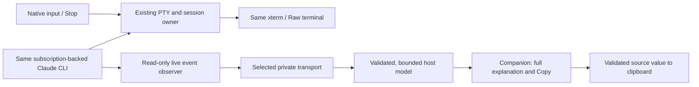

# Copy-friendly Claude Code companion

* **Author:** Christopher Beaulieu
* **Status:** Draft — Overview & Goals approved; live capture selected; Technical Plan awaiting transport selection and section approval. [O; L]
* **Date:** 2026-11-06
* **Parent:** [#215](https://github.com/glitchwerks/vscode-claude-workspaces/issues/215)
* **Predecessor:** [Finalized concepts brief](concepts_brief.md), approved for this first-version scope and formal drafting. [A]

Overview, The Problem, Goals and Non-Goals were approved on 2026-11-06. The author subsequently selected live capture only. The Technical Plan below proposes the common design and two [transport variants](technical_choices.md#decision-2-live-content-transport) for selection; it is not yet approved. Alternatives and detailed implementation remain to be drafted. This document is not product implementation or release authorization. [A; O; L]

## Overview

Provide a companion view for the existing subscription-backed Claude Code CLI that keeps Claude's full explanation readable while making commands and file/folder paths easy to copy. Show commands in separate blocks with Copy actions, and place Copy buttons beside paths in prose or inline code. Do not replace the explanation with an extracted-item list or short context snippets. [B:Overview; B:Goals vs. Non-Goals]

The same native CLI remains available through a raw-terminal toggle, including its question/permission interactions and native foreground Escape behavior. Direct question and permission controls are optional, rather than prerequisites for the copying feature. The technical design must keep these existing access paths usable while defining how complete, source-backed copy targets reach the companion. [B:Confirmed foundation; B:Native interaction remains a real integration concern]

## The Problem

Selecting a command from a terminal is awkward when it wraps across visual rows. File/folder paths are also mixed into Claude's explanation or inline code, so selecting them can accidentally include surrounding words or formatting. The user wants a direct Copy action for the complete command or just the path. [B:Overview; H:Anchored hypothesis and user problem]

Removing the explanation would make those items easier to isolate but would discard context the user explicitly wants to retain. The required experience therefore combines full explanation text with distinct command blocks and adjacent path controls. [B:Keep the full explanation; copy from source rather than presentation; F]

Copy targets also need honest boundaries. A path with spaces, quotes or punctuation may be uncertain; a command-shaped example is not automatically an instruction or an executed command. Clear paths must remain one-click, while uncertain paths must show the exact candidate and permit correction before copying. Source-backed provenance must distinguish what Claude displayed from what it actually ran. [B:Prose/inline paths remain core; B:Copyability and intent are different claims; P]

The experiments support feasibility for controlled command copying and the tested native interactions. They do not prove general prose-path recognition, reliable command-intent classification, packaged-extension behavior, accessibility or long-session performance. These remain acceptance and technical-design work, not capabilities this draft claims already exist. [B:Evidence supports further consideration; R:M1-M6]

## Goals

1. **Copy complete commands.** A Copy action returns the full intended command, preserving meaningful quoting and newlines without introducing terminal visual-wrap artifacts. Keep copying available for commands Claude displays and, where established by source evidence, commands it executed. [B:Goals vs. Non-Goals]
2. **Copy just file/folder paths.** Recognize paths within explanations and inline code, and put Copy beside the relevant path. The resulting value excludes surrounding prose and Markdown formatting. Clear paths require a single Copy action. [B:Goals vs. Non-Goals; P]
3. **Preserve full explanation context.** Keep the entire captured explanation visible and readable, including headings, lists and code; show commands in separate Copy blocks. An extraction-only view or shortened context is not a substitute. [B:Overview; F]
4. **Make uncertain path copying explicit.** Before copying an uncertain candidate, show exactly what would be copied and allow the user to correct it. Do not silently guess, and do not impose correction on ordinary clear paths. [B:Confirmed refinement, 2026-11-06; P]
5. **Retain trustworthy provenance.** Distinguish assistant-displayed examples/suggestions from source-confirmed tool execution. Do not let a Copy button imply that a command was recommended or ran merely because it looks like a shell command. Exact labels are a later design decision. [B:Copyability and intent are different claims]
6. **Keep the subscription-backed session.** Use the same interactive Claude Code CLI without requiring a separate API key, separately billed inference backend or replacement session for the companion. [B:Retained constraints; H:Confirmed needs and boundaries]
7. **Preserve native interaction and Stop.** The raw-terminal toggle remains usable for answering questions, approving/denying requests and other native interactions. Retain native foreground Escape semantics and do not equate a turn-abort acknowledgement with stopping a running command. Direct controls may be included separately if selected later. [B:Native interaction remains a real integration concern; B:Goals vs. Non-Goals]
8. **Make Copy usable and its limits visible.** Support keyboard-reachable actions, identifiable targets and perceivable success/failure feedback. Partial or unavailable capture must not masquerade as a complete copy target or full explanation. The exact acceptance checks and operating limits belong to the technical plan. [B:Proposed safeguards for the selected view; R:M1, M4-M6]

## Non-Goals

* Replacing the full explanation with a path/command list or small excerpts. The maintainer explicitly selected full context. [F]
* Automatically executing commands when they are copied. The tracked work is an output/copying feature, not command-execution automation. [#215; H:Confirmed needs and boundaries]
* Replacing subscription sign-in/inference with a separate API backend, or starting another CLI process solely for formatted output. [B:Retained constraints; R:M6]
* Making direct question/permission controls mandatory for first-version copying. Optional status is confirmed; whether to include them is still a technical-scope choice. [B:Goals vs. Non-Goals; R:M7]
* Treating full explanation visibility as a promise of unlimited retained history, complete native-interface replication or universal cancellation of background work. Capture/history limits still need to be designed without quietly discarding visible context. [B:Goals vs. Non-Goals; B:Native interaction remains a real integration concern]
* Adding path-opening/resolution, silent path transformations or a general intent-classification service as hidden prerequisites for Copy. Such behavior has not been selected; any proposed transformation or added dependency must be an explicit technical-design decision. [B:Prose/inline paths remain core; B:Alternatives Weighed]
* Implementing or releasing product changes during this drafting workflow. This authorization covers design documents. [A]

## Technical Plan

Everything in this section is proposed for approval except the already selected live-only source and the requirements above. Selecting a transport variant and approving this section would establish the shared architecture below; it would not establish that its untested behavior works. Detailed Implementation must resolve the remaining recognition rules, operating limits, file inventory and acceptance fixtures before implementation could begin. [L; B:Remaining formal-design work; R:M1-M6]

### Data flow and ownership

Keep one subscription-backed CLI with two output paths. Its existing PTY continues feeding the same xterm. An observational mod sends allowed live content through a separate channel to an extension-owned companion model; the webview renders that model. Capture must continue native event processing unchanged and must not wait for a webview, transport acknowledgement or user action. The experiments support the event approach only within their recorded cases. [L; E; X; C; proposed integration]

The host retains the current reading window independently of the webview. Recreating a webview can project that retained model again; this is not CLI snapshot recovery. Do not call session.messages, tail transcript files or reconstruct commands from terminal rows. On late attachment, loss or eviction, insert a visible boundary explaining what is unavailable. Do not silently join text across a gap. [L; C; R:M1, M4; proposed failure contract]

Observe only assistant-visible explanation text and the tool command/result evidence needed for the displayed output. Do not forward hidden reasoning, signatures, arbitrary internal payloads or the whole session environment. Keep content out of the metadata-only attention publisher and ordinary diagnostics. Attention retains its existing notification ownership; the companion does not introduce a second activity-state authority. [B:Retained constraints; R:M6; M; proposed capture boundary]

### Protocol and retained model

Define a separate versioned content protocol. Each accepted frame is bound to the managed session, canonical CLI session identity, process generation and capture epoch, with sequence/revision information and native message/tool identities where available. The host derives current ownership from its own session state, validates payload shape/size, rejects stale or duplicate frames and exposes missing sequences as gaps. A local sequence number cannot establish a native message identity that the source did not provide. Identity and update behavior need qualification against the installed CLI declarations. [C; S; R:M1, M3-M4; proposed protocol]

The host owns ordered explanation blocks, source text revisions, associated tool evidence and immutable copy targets. A target records its source block/revision/range, complete literal value, kind and provenance. Rendering may wrap or add controls, but cannot manufacture the copied value. Any revision that changes a target invalidates its earlier action rather than silently copying a newer value under an old button. Incomplete payloads have no enabled complete-value Copy action. [B:Keep the full explanation; copy from source rather than presentation; R:M1, M3-M4; proposed model]

Transport queues, frames, retained content and view updates must have finite limits. Evict complete older blocks with an explicit history boundary; do not silently retain only the tail of a command or explanation. Oversized/incomplete blocks must be visibly unavailable for exact Copy, with raw access. Detailed Implementation will name byte/count/time limits, queue overflow behavior and slow-reader tests for the selected transport. The current PTY replay limit is not a rich-history retention policy. [X; R:M1, M4, M6; proposed limits]

### Full explanation, command blocks and path controls

Render the full retained explanation with headings, lists and code, preserving its order and context. Put command content in distinct blocks within that reading stream; place path actions beside their spans in prose and inline code. Keep tool requests/results visibly separate from Claude's explanation. Use text labels, keyboard-reachable buttons and perceivable Copy feedback rather than relying on color. Do not replace explanation paragraphs with extracted snippets. [B:Overview; F; R:M1-M3, M6; proposed presentation]

Use a source-mapped rendering/extraction layer so every action refers to retained source text, not DOM text or terminal selection. The runtime already uses markdown-it with raw HTML disabled, restricted links and image placeholders; those safety conventions are candidates for reuse. Its composer preview is not a ready-made source-mapped output renderer, and its reference parser deliberately skips inline code, so neither establishes the required path-copy behavior. [K; proposed reuse boundary]

For commands, copy the complete retained command body, excluding Markdown fence delimiters and added UI. Preserve meaningful quoting, spaces and logical newlines; never add visual-wrap breaks or silently trim the value. The Windows clipboard qualification permits only the previously tested one-to-one LF-to-CRLF newline conversion. Suggested/example identification must not change the value. A finalized command can become copyable while the surrounding explanation continues, provided its own source boundary is complete. Exact command-recognition forms remain Detailed Implementation work. [B:Goals vs. Non-Goals; E; R:M1, M3; proposed copy contract]

For paths, store the source span and literal path value separately from nearby Markdown/prose. Clear boundaries get one-click Copy. Uncertain boundaries get an editable preview of exactly the candidate value, with Copy after review; editing this preview changes only the local copy value. Do not resolve against the file system, expand variables, normalize slashes, remove quotes or strip line suffixes without an explicit agreed boundary rule. Supported Windows/POSIX, relative, quoted, spaced and line-suffixed forms need fixtures before implementation. General path recognition remains unproven. [P; B:Prose/inline paths remain core; R:M2; proposed extraction boundary]

### Provenance and clipboard actions

Keep assistant-displayed commands distinct from tool execution evidence. Proposed labels are **Suggested command** only when the supported source/context rule establishes an instruction, otherwise **Command shown by Claude**. A tool request alone is **Requested by Claude**, not proof of execution. Use an execution label only when correlated native evidence establishes it, with separate completion/interruption/unknown status; a single turn-abort flag is insufficient. No additional model call classifies intent. Detailed Implementation must specify the evidence table and ambiguity fixtures. [B:Copyability and intent are different claims; E3; R:M3; proposed labels]

A webview Copy action names the current target and revision; it cannot supply an arbitrary native input action. The host validates that the target still belongs to the displayed session and remains complete, then writes its stored literal value to the clipboard. For an uncertain path, the explicitly reviewed edited value is the value shown and copied. Failed or stale actions report failure and do not silently switch targets. Copy never submits to the composer, writes to the PTY or opens a path. [B:Goals vs. Non-Goals; P; R:M1-M3; proposed action contract]

Treat captured content as untrusted text: disable raw HTML/scripts and remote resource loading, use the panel's controlled link boundary and CSP, and create Copy controls only from extension-owned rendering logic. Assistant text cannot create permission or Stop actions. This extends the existing safe-preview conventions to the new renderer; it is not a claim that the composer preview already meets the output feature. [K; R:M6; proposed rendering boundary]

### Native access, Stop and optional controls

An always-available Companion / Raw terminal toggle switches presentation while retaining the same live PTY/xterm and composer draft. Preserve each view's scroll position. Selecting Raw terminal focuses that terminal; incoming output or capture failure must not steal focus. Questions and permissions remain answerable through native access regardless of capture health. The copying plan does not require a new question/permission owner. Direct controls retain their approved optional status and need a separate explicit inclusion decision before Detailed Implementation is final. [B:Confirmed foundation; R:M5, M7; X; proposed integration]

Stop sends one native Escape through the selected CLI's existing input path after checking the current session/generation. It must not depend on the content channel, globally capture editor Escape or queue a stale keystroke for another generation. Report input sent separately from confirmed interruption, and do not claim to stop already backgrounded work. Do not use turn.abort for Stop: the focused experiment observed a running shell become backgrounded and later finish, whereas native Escape stopped the timed fixture. Detailed Implementation must cover target freshness and pending native-dialog cases. [E3; N; B:Native interaction remains a real integration concern; proposed Stop integration]

### Components and API changes

These are proposed component locations for future implementation, not missing deliverables of this documentation PR. Detailed Implementation will enumerate every actual source, test and documentation file once the remaining choices are settled. [B:Remaining formal-design work]

| Component | Proposed responsibility / existing integration |
|---|---|
| New `media/companion/` observer | Capture allowlisted semantic events without changing their continuation; load through the existing mod entry without adding content to attention. [M; proposed] |
| New `src/companion/` host components | Own the chosen transport, schema/target checks, bounded source model, gaps and lifecycle cleanup. Reuse lifecycle conventions from the composer, with a separate content protocol. [C; proposed] |
| New `src/panel/companionProtocol.ts` | Define the host/webview projection and revision-bound Copy actions. Native input remains a separately validated action. [B:Remaining formal-design work; proposed] |
| New `src/panel/webview/companion/` components | Render full explanations, command blocks, source-bound path actions and uncertainty previews; handle focus and Copy feedback. [F; P; proposed] |
| Existing panel provider and renderer | Add companion projection/toggle routing while retaining xterm hydration/live output and the current input owner. [X; N; proposed] |
| Existing launch/session lifecycle | Provision and retire capture bindings with the owning process generation; do not change subscription authentication or launch a second CLI. [C; L; proposed] |

No Claude inference/API backend is added. The new APIs are local mod-to-host content frames and host-to-webview projections/actions. The transport remains the explicit choice between private files and authenticated loopback HTTP described in [Decision 2](technical_choices.md#decision-2-live-content-transport), including mechanisms, costs and failure cases. Neither is selected by the live-source decision. [L; C; proposed API boundary]

### Qualification before a product change

The recorded baseline is Claude Code 2.1.317 / Pro on the tested local Windows setup, not a general minimum or a supported-version matrix. Qualify the chosen source/transport in a packaged extension before declaring copying reliable. Required cases include long/multiline commands and actual clipboard values, clear/uncertain inline and prose paths, full explanation preservation, source updates/stale actions, denied and interrupted tools, gaps/overflow, session replacement, webview recreation, multiple sessions, keyboard/screen-reader use and native Stop/toggle behavior. Test transport privacy/cleanup or listener authentication as appropriate. [E; E3; R:M1-M7; proposed qualification]

If capture is unavailable or incompatible, present its status and raw-terminal access. A working terminal is a fallback, not evidence that the promised rich copying works. No new live experiment, supported CLI floor, delivery estimate or release claim is established by this design checkpoint. [B:Evidence supports further consideration; R:M6; proposed failure boundary]

## Open Questions

These are remaining design decisions, not questions the author is being asked to answer together. The already approved copying priority, full-explanation layout, uncertainty preview and optional-control status are not reopened. [A; B:Key Decisions & Staging for Next Steps]

* **Live transport:** choose [private files or authenticated loopback HTTP](technical_choices.md#decision-2-live-content-transport) and approve or revise the shared Technical Plan. Live-only capture is selected; CLI snapshot recovery is deferred. [L; B:Remaining formal-design work; R:M1, M3-M4]
* **Path-copy contract:** define supported recognition forms, boundary rules, quotes/line suffixes and any explicit transformations. Preserve the approved one-click/uncertainty interaction. [B:Remaining formal-design work; R:M2]
* **Stable copy targets and labels:** define identity across updates, clipboard/newline semantics, source-to-render mapping and provenance wording. [B:Remaining formal-design work; R:M1, M3-M4]
* **Capture/history and privacy limits:** define retention, gaps, oversized content, diagnostics and failure behavior while keeping complete visible explanations and native access. [B:Remaining formal-design work; R:M4, M6]
* **Native integration and optional controls:** define focus/Stop routing and whether direct question/permission controls are included or deferred. [B:Remaining formal-design work; R:M5, M7]
* **Qualification:** define the supported CLI/host combinations and packaged tests for source fidelity, ordinary and ambiguous paths, accessibility, lifecycle and performance. The probes establish only their recorded cases. [B:Evidence supports further consideration; R:M1-M6]

## Additional Resources

* **B:** [Finalized concepts brief](concepts_brief.md), with [the accepted intake content at commit 3b096d8](https://github.com/glitchwerks/vscode-claude-workspaces/blob/3b096d8de36f596d42276e78bcf60c25c7d3a0bb/docs/designs/215/concepts_brief.md). Named B sections refer to that accepted intake; earlier headings such as Proposed safeguards distinguish requirements from still-open technical choices. A records the subsequent approval/finalization.
* **H:** [Fixed Goldfish working hypothesis](working_hypothesis.md), [committed at the review checkpoint](https://github.com/glitchwerks/vscode-claude-workspaces/blob/fe9d42be1890b060fd0522d956f28082b6018861/docs/designs/215/working_hypothesis.md). Historical review input; its frozen content predates later confirmed context and preview decisions.
* **R:** [Seven-lens Goldfish review report](goldfish_review_report.md), [committed at the review checkpoint](https://github.com/glitchwerks/vscode-claude-workspaces/blob/fe9d42be1890b060fd0522d956f28082b6018861/docs/designs/215/goldfish_review_report.md). M1-M7 identify the consolidated findings and their evidence limits; it was not rerun to imply review of later decisions.
* **A:** [Maintainer approval of the first-version brief and authorization for egm-draft](https://github.com/glitchwerks/vscode-claude-workspaces/issues/215#issuecomment-6684810864).
* **P:** [Approved path-copy uncertainty behavior](https://github.com/glitchwerks/vscode-claude-workspaces/issues/215#issuecomment-6684329277).
* **F:** [Approved full-explanation and Copy layout](https://github.com/glitchwerks/vscode-claude-workspaces/issues/215#issuecomment-6684608334).
* **O:** [Overview & Goals approval and transition to Technical Plan](https://github.com/glitchwerks/vscode-claude-workspaces/issues/215#issuecomment-6685022793).
* **L:** [Author selection of live capture only and explicit gaps](https://github.com/glitchwerks/vscode-claude-workspaces/issues/215#issuecomment-6700896861).
* **C:** [Source decision and transport choices](technical_choices.md), including pinned runtime channel sources and dated official API documentation.
* **S:** [Read-only live/snapshot interface research](https://github.com/glitchwerks/vscode-claude-workspaces/issues/215#issuecomment-6685055630), preserving the inspected CLI declaration limits; snapshots remain deferred.
* **E:** [Controlled event/copy experiment](https://github.com/glitchwerks/vscode-claude-workspaces/issues/215#issuecomment-6646355033) and [preserved source/receipts](https://github.com/glitchwerks/vscode-claude-workspaces/issues/215#issuecomment-6646341085).
* **E3:** [Focused native/direct-control and Stop findings](https://github.com/glitchwerks/vscode-claude-workspaces/issues/215#issuecomment-6647481988), with [preserved source/receipts](https://github.com/glitchwerks/vscode-claude-workspaces/issues/215#issuecomment-6647462596). Direct-control feasibility is not a first-version inclusion decision.
* **M:** [Existing mod entry and metadata-only attention boundary](https://github.com/glitchwerks/vscode-claude-workspaces/blob/ef5fd48f4b676881a8730afbf8e583e70565ca11/media/attention/hooks/register.js#L1-L35).
* **X:** [Existing xterm input/output/focus adapter](https://github.com/glitchwerks/vscode-claude-workspaces/blob/ef5fd48f4b676881a8730afbf8e583e70565ca11/src/panel/webview/xtermTerminal.ts#L85-L130) and [panel PTY replay/live hydration](https://github.com/glitchwerks/vscode-claude-workspaces/blob/ef5fd48f4b676881a8730afbf8e583e70565ca11/src/panel/sessionPanelProvider.ts#L615-L681).
* **K:** [Existing safe Markdown preview](https://github.com/glitchwerks/vscode-claude-workspaces/blob/ef5fd48f4b676881a8730afbf8e583e70565ca11/src/panel/webview/composer/markdownPreview.ts#L1-L25) and [composer reference parser, including skipped inline code](https://github.com/glitchwerks/vscode-claude-workspaces/blob/ef5fd48f4b676881a8730afbf8e583e70565ca11/src/panel/webview/composer/references.ts#L1-L48).
* **N:** [Existing session-owned PTY input](https://github.com/glitchwerks/vscode-claude-workspaces/blob/ef5fd48f4b676881a8730afbf8e583e70565ca11/src/sessions/sessionManager.ts#L340-L378) and [panel renderer input handling](https://github.com/glitchwerks/vscode-claude-workspaces/blob/ef5fd48f4b676881a8730afbf8e583e70565ca11/src/panel/webview/renderer.ts#L380-L487).

*Drafted with EGM*
